# WardMate — Sơ đồ phân tích hệ thống

> Cập nhật triển khai local 16/10/2026: luồng xác nhận giấy tờ đã được code bằng DOCUMENTS_READY/documentsReadyAt và submission ReadyForDownload. Các ảnh xuất ngày 15/10 là bản thiết kế tại thời điểm đó; nhãn “backend pending” trong ảnh đã được thay thế bởi cập nhật này. Chưa deploy/migrate Azure cho thay đổi mới. ERD cũ vẫn giữ để đối chiếu; migration DocumentReadiness bổ sung documents_ready_at.

> **Điều chỉnh phạm vi ngày 15/10/2026:** WardMate hỗ trợ chuẩn bị và kiểm tra giấy tờ trước khi đến phường; không phê duyệt hoặc từ chối giải quyết hồ sơ hành chính. Các sơ đồ Application/Document/QR dưới đây là thiết kế mới, **chưa triển khai vào backend**. `DOCUMENTS_READY` và `ReadyForDownload` là tên trạng thái đề xuất, chưa phải giá trị API. ERD được giữ nguyên để đối chiếu: các cột/trạng thái APPROVED, REJECTED, ApprovedAt và thiết kế approved_qrs/metrics cũ không có nghĩa còn thuộc phạm vi nghiệp vụ đích. Việc giải quyết chính thức tại phường nằm ngoài hệ thống.

Đối chiếu mã nguồn ngày 15/10/2026 (Asia/Saigon, UTC+07:00).

Mục 1–5 mô tả **backend đang có trong workspace**; mục 6 bổ sung **ERD tương lai theo đặc tả gốc**; mục 7 liên kết bộ **Activity, State Machine và Structure Analysis đích cho cả 6 service**. Các phần tương lai chưa phải entity/migration/API đã triển khai. Tài liệu không xác nhận các revision trên Azure. Sơ đồ dùng Mermaid: mở Markdown Preview có hỗ trợ Mermaid để xem hình; phần mã vẫn chỉnh sửa được bằng IDE. ERD chỉ hiển thị các cột chính để dễ đọc, không thay thế migration.

- [ERD](#1-erd--mô-hình-dữ-liệu): dữ liệu và quan hệ.
- [Activity Diagram](#2-activity-diagram--luồng-hoạt-động): ai làm gì và các nhánh xử lý.
- [State Machine](#3-state-machine--vòng-đời): trạng thái và điều kiện chuyển trạng thái.
- [Structure Analysis](#4-structure-analysis--phân-tích-cấu-trúc): phân rã chức năng, kiến trúc và luồng dữ liệu.
- [ERD tương lai đủ 6 service](#6-erd-tương-lai--đủ-6-microservices): bảng chưa triển khai và bản đồ dữ liệu đích.
- [Luồng và cấu trúc tương lai đủ 6 service](system-future-flows.md): Activity, State Machine, phân rã chức năng và DFD; phân biệt đã làm/một phần/dự kiến.
- [ERD tổng thể 42 bảng trong một hình](system-unified-erd.md): nối cấp bảng giữa 6 service, phân biệt FK và REF; giữ nguyên các ERD riêng.

## 1. ERD — Mô hình dữ liệu

Các đường nối trong năm ERD bên dưới là FK được cấu hình bằng EF Core. Các ID tham chiếu service khác chỉ là **liên kết logic**, được vẽ riêng ở mục 1.6. Nullable ghi trong chú thích cột. Các thuộc tính C# được giữ nguyên tên để tìm trong source.

### 1.1. IAM — tài khoản và phân quyền

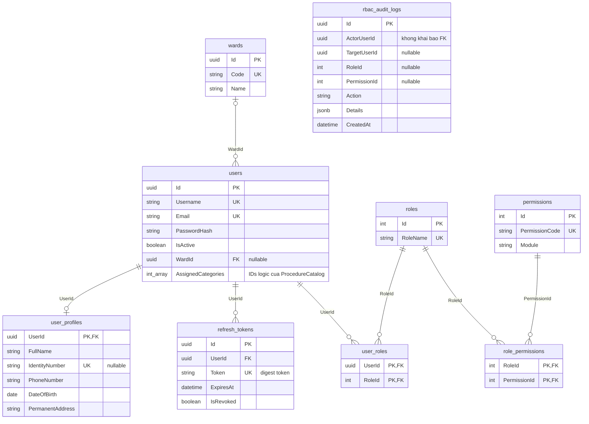

Manager bị giới hạn theo phường trong nghiệp vụ; quan hệ `users.WardId` không tự thực hiện kiểm tra quyền. Profile có thể bị xóa trong khi tài khoản vẫn tồn tại. Audit lưu dấu vết thao tác, không có đường FK đến User/Role/Permission trong mapping hiện tại.

### 1.2. ProcedureCatalog — thủ tục và bản nháp PDF

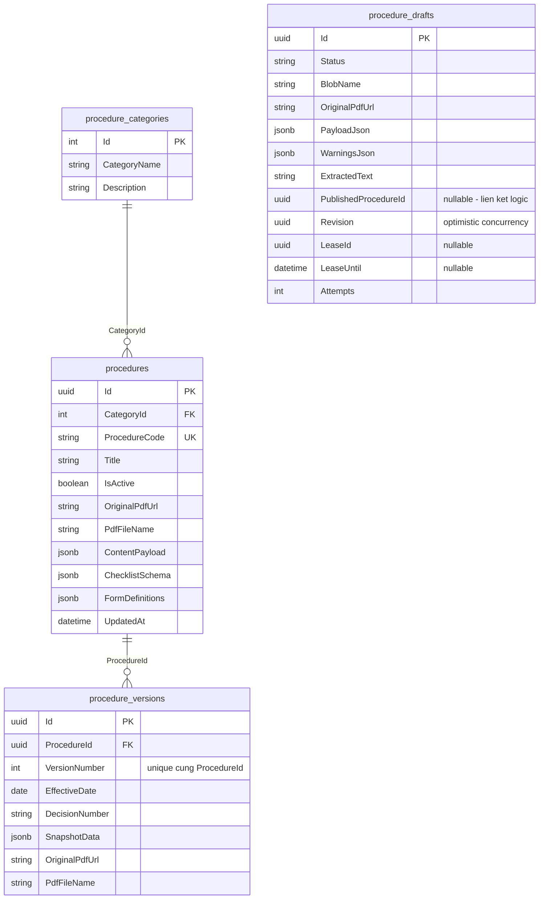

`ContentPayload.Cases`, `ChecklistSchema` và `FormDefinitions` là dữ liệu JSONB, **không phải các bảng riêng**. `FormTemplateId` trong JSON là ID của DocumentForm. `PublishedProcedureId` không được cấu hình FK trong mapping bản nháp.

### 1.3. ApplicationWorkflow — hồ sơ công dân

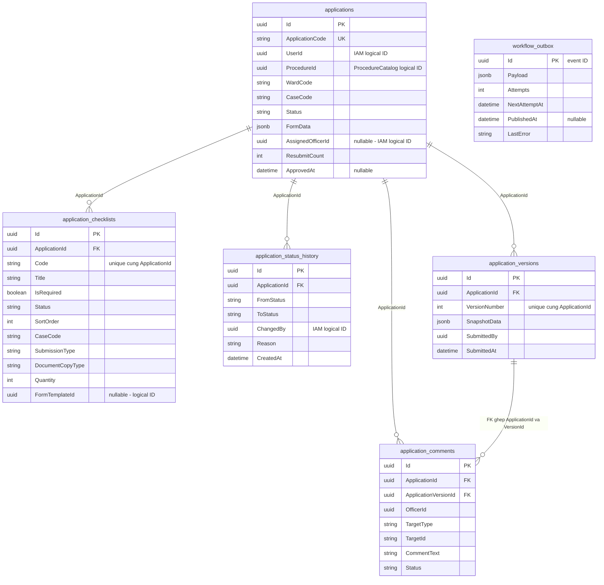

Checklist của Application là bản sao yêu cầu lúc tạo hồ sơ, không đọc động từ thủ tục mỗi lần hiển thị. Outbox chứa sự kiện JSON, không có FK trực tiếp tới hồ sơ. Bình luận thuộc đúng một version của đúng hồ sơ nhờ FK ghép.

### 1.4. DocumentForm — phôi, biểu mẫu đã điền và file

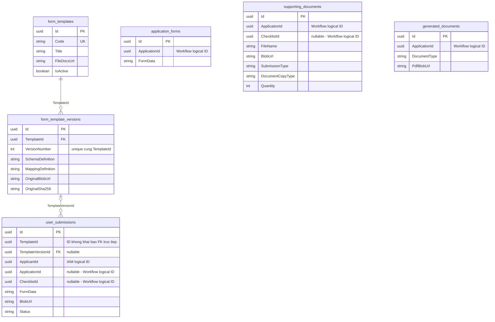

Các bảng nằm trong schema `document`. `ApplicationForm` và `UserSubmission` là hai thực thể riêng trong code; không đồng nhất chúng với hồ sơ `applications`. File nhị phân nằm ở Blob, database lưu metadata/đường dẫn. Không vẽ FK `TemplateId` của UserSubmission vì mapping hiện tại chỉ khai báo FK `TemplateVersionId`.

### 1.5. AnalyticsSystem — thông báo và giao nhận

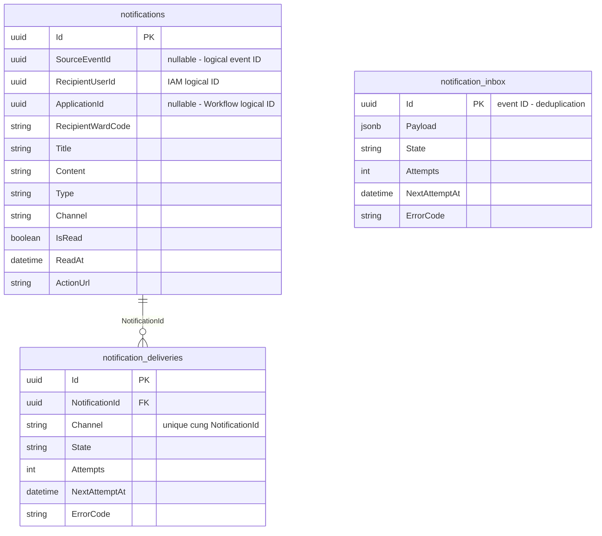

Inbox và Notification liên kết theo event ID trong nghiệp vụ, không có FK được khai báo. Gửi realtime thành công không đồng nghĩa người dùng đã đọc. AIOCR và Gateway không có DbContext nghiệp vụ trong phạm vi source đã đối chiếu.

### 1.6. Liên kết logic giữa các service

Tất cả đường nét đứt dưới đây là tham chiếu ID/sao chép dữ liệu, **không phải FK xuyên database**.

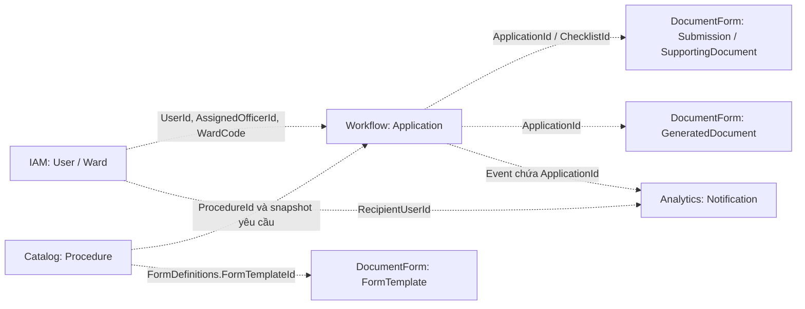

## 2. Activity Diagram — Luồng hoạt động

Đã bổ sung [**bản vẽ UML tiếng Anh theo ảnh mẫu**](diagrams/activities/index.html), [file draw.io chỉnh sửa được](diagrams/activities/wardmate-activities.drawio) và [Mermaid source](diagrams/activities/README.md). Các bản phân tích hiện trạng bên dưới được giữ nguyên để đối chiếu nghiệp vụ.

Các sơ đồ dùng flowchart Mermaid để biểu diễn hoạt động, điểm quyết định và vùng trách nhiệm; không phải bản xuất UML/XMI.

### 2.1. PDF → đối soát → thủ tục chính thức

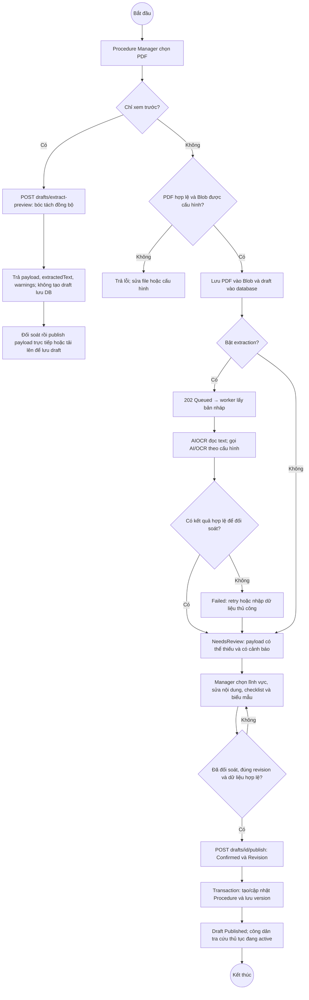

Không tự xuất bản kết quả AI. Nhánh preview không tự tạo `draftId`; không dùng ID tưởng tượng để gọi draft publish. `POST procedures/publish` là luồng nhận payload đã đối soát trực tiếp, khác với publish draft đã lưu.

### 2.2. Prepare Documents and Visit Ward Office — thiết kế mới

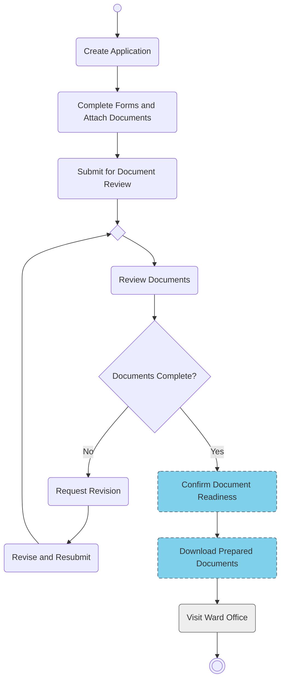

Nhánh No yêu cầu sửa/bổ sung rồi kiểm tra lại; không phải từ chối giải quyết. Nhánh Yes chỉ xác nhận giấy tờ sẵn sàng. Visit Ward Office là hành động ngoài hệ thống.

### 2.3. Thông báo bất đồng bộ

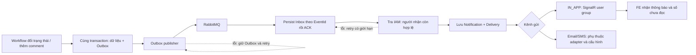

Email/SMS thật chưa được coi là hoàn tất. Event ID và unique index chống xử lý trùng ở mức lưu dữ liệu; không khẳng định toàn hệ thống gửi đúng một lần tuyệt đối.

## 3. State Machine — Vòng đời

### 3.1. Application — trạng thái đề xuất cho kiểm tra giấy tờ

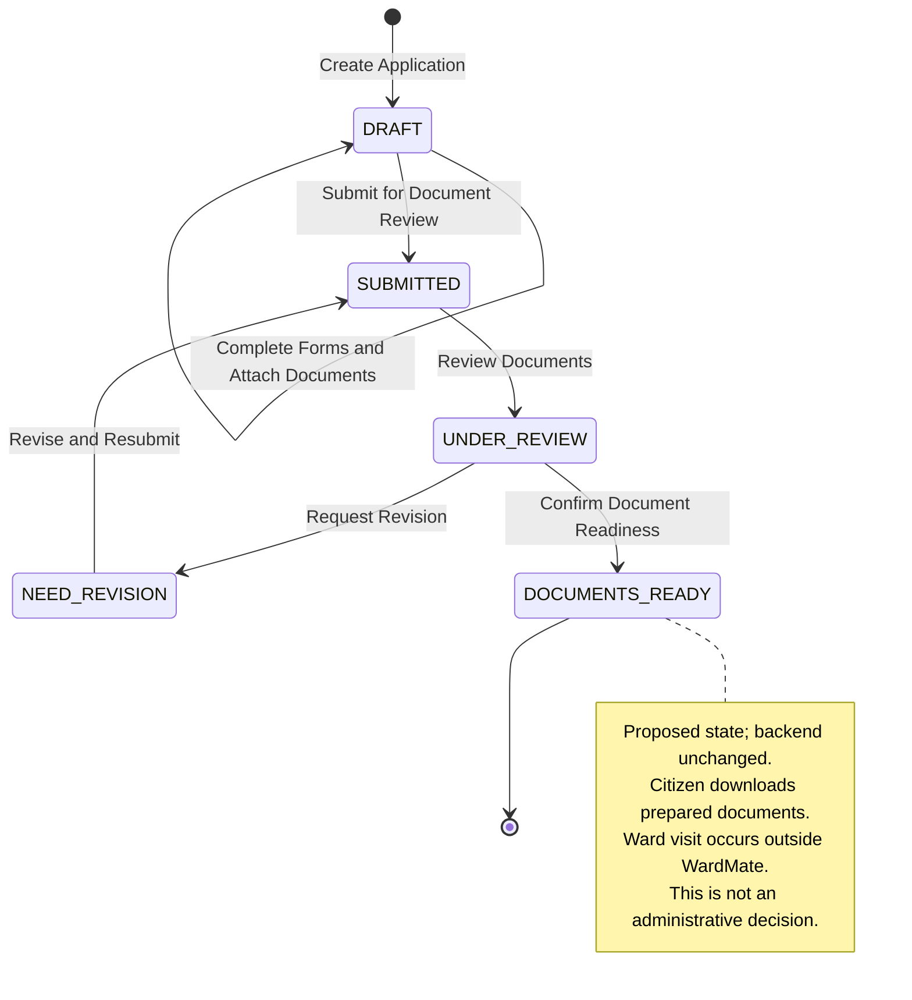

### 3.2. ProcedureDraft — bản nháp bóc tách PDF

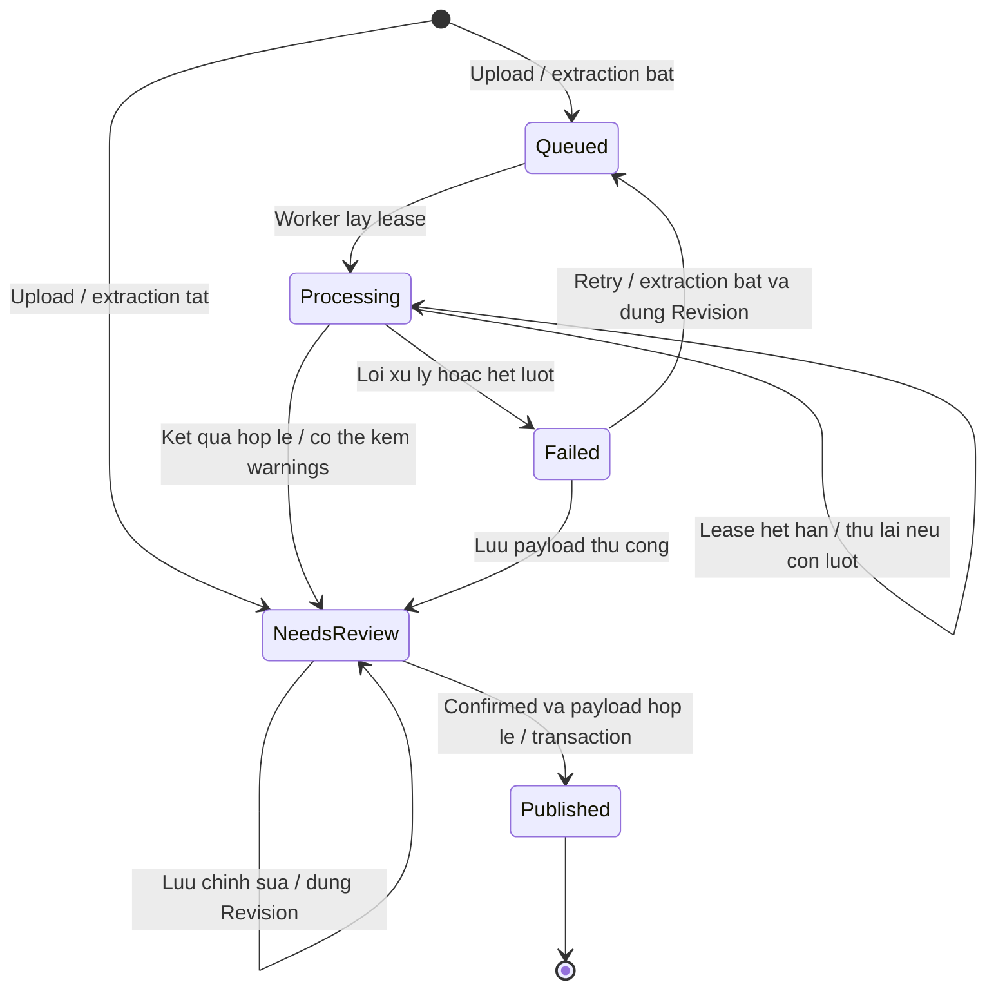

Worker dùng lease để tránh nhiều worker ghi cùng draft; tối đa 3 lần nhận xử lý trong chu kỳ trước khi `Failed`. Retry thủ công reset số lần. Preview đồng bộ không đi qua state machine này.

### 3.3. UserSubmission — biểu mẫu chuẩn bị, thiết kế mới

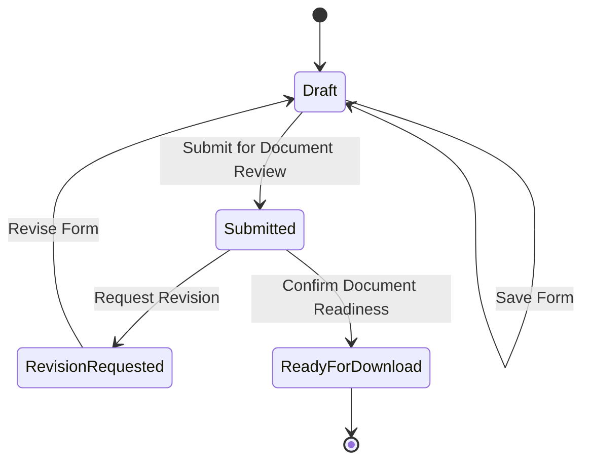

Đây là vòng đời đề xuất của biểu mẫu, không phải quyết định hành chính. Cơ chế đồng bộ và điều kiện PDF hiện tại vẫn còn dùng trạng thái cũ; sẽ sửa code ở task sau.

## 4. Structure Analysis — Phân tích cấu trúc

Ở đây “Structure Analysis” gồm phân rã chức năng (FDD), kiến trúc service và sơ đồ dòng dữ liệu (DFD). DFD là mô hình phân tích, không phải sơ đồ gọi HTTP chi tiết từng endpoint.

### 4.1. Phân rã chức năng

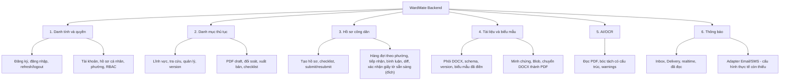

Tên service `AnalyticsSystem` hiện không tự chứng minh đã có đầy đủ dashboard, báo cáo hay Knowledge Base/RAG. Các chức năng đó không được thêm vào sơ đồ như phần đã hoàn thành.

### 4.2. Kiến trúc service và hạ tầng

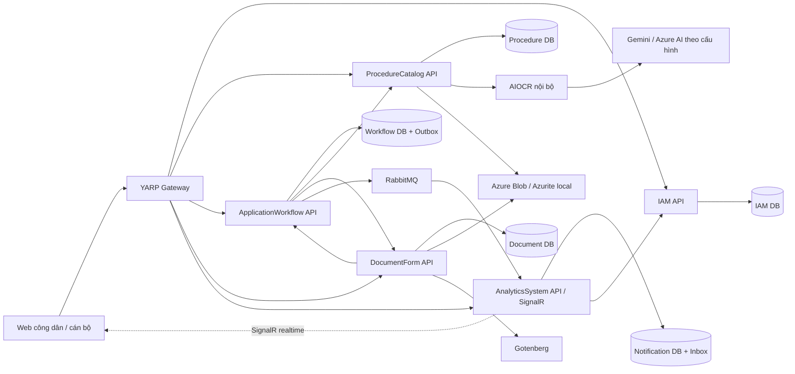

Đây là kiến trúc logic; URL và đường route cụ thể tùy cấu hình local/Azure. Các service không truy vấn trực tiếp database của nhau. JWT bảo vệ API người dùng; các lời gọi nội bộ dùng cơ chế xác thực nội bộ theo cấu hình. Không suy ra service đã deploy từ việc nó có mặt trong sơ đồ.

### 4.3. Clean Architecture — chiều phụ thuộc mã nguồn

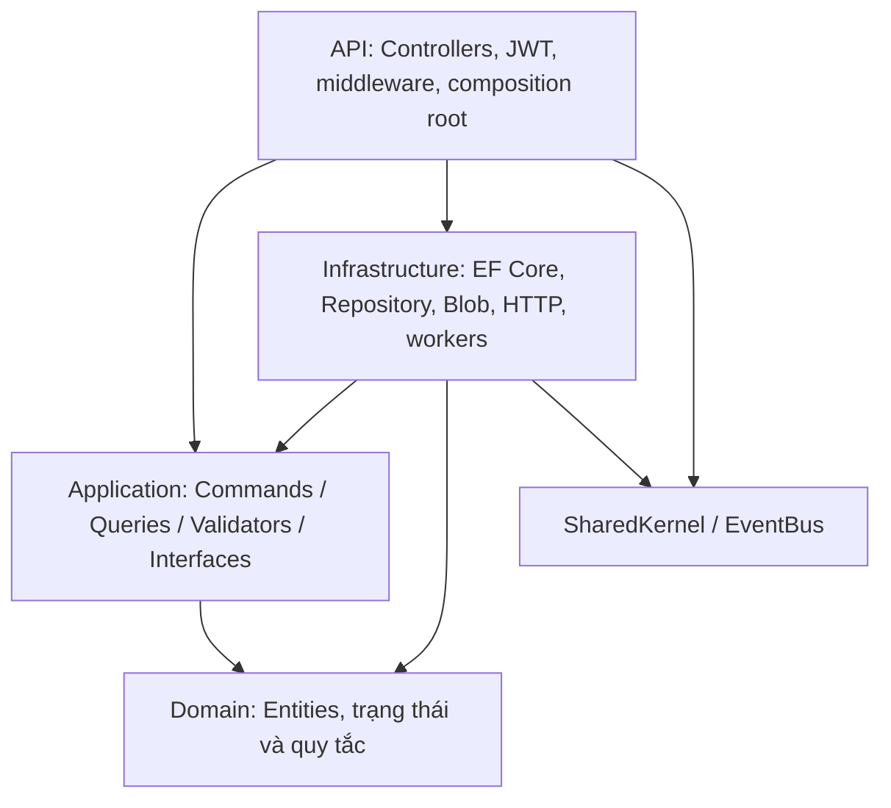

Mũi tên biểu diễn phụ thuộc, không phải thứ tự xử lý request. API đăng ký implementation Infrastructure vào DI; Application gọi qua interface. Cách tổ chức file chi tiết khác nhau giữa các service, sơ đồ mô tả ranh giới trách nhiệm chung.

### 4.4. DFD mức ngữ cảnh

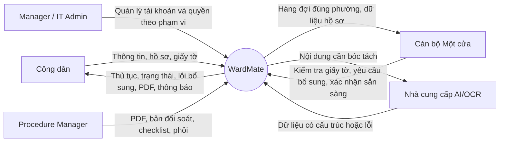

### 4.5. DFD mức 1 — xử lý hồ sơ

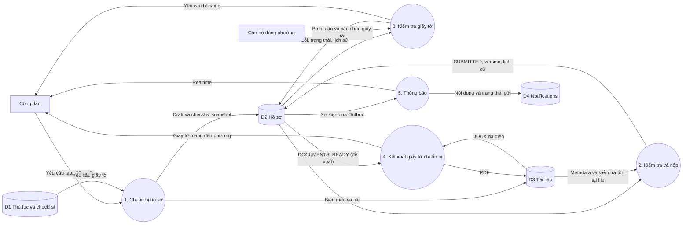

## 5. Nguồn đối chiếu và giới hạn

- IAM: `src/Services/WardMate.Services.IAM/WardMate.Services.IAM.Domain/Entities/` và `WardMate.Services.IAM.Infrastructure/Persistence/Configurations/`.
- Catalog: `src/Services/WardMate.Services.ProcedureCatalog/WardMate.Services.ProcedureCatalog.Domain/Entities/`, `Application/Drafts/ProcedureDraftService.cs` trong project Application và `Infrastructure/Drafts/DraftExtractionWorker.cs` trong project Infrastructure.
- Workflow: `src/Services/WardMate.Services.ApplicationWorkflow/WardMate.Services.ApplicationWorkflow.Domain/`, project Application: `WorkflowRequests.cs`, `ReviewHandlers.cs`, `FinalDecisionRequests.cs`; project Infrastructure: `WorkflowDbContext.cs`, `WorkflowOutbox.cs`.
- DocumentForm: `src/Services/WardMate.Services.DocumentForm/WardMate.Services.DocumentForm.Domain/Entities/`, project Infrastructure: `Persistence/Configurations/`; project API: `Security/ApplicationAccess.cs`.
- Notifications: `src/Services/WardMate.Services.AnalyticsSystem/WardMate.Services.AnalyticsSystem.Infrastructure/NotificationDbContext.cs` và các worker cùng service.
- Hướng dẫn sử dụng và quy tắc chi tiết: [API guide](api-guide.md), [System constraints](system-constraints.md), [Progress](../PROGRESS.md).

Tài liệu không xác nhận độ chính xác tuyệt đối của AI, giao dịch nguyên tử xuyên service, gửi thông báo exactly-once, SMS/Email production, hay kiểm thử toàn luồng Azure. Khi bổ sung entity, FK hoặc chuyển trạng thái mới, cần sửa sơ đồ tương ứng thay vì coi sơ đồ này là đặc tả bất biến.

## 6. ERD tương lai — Đủ 6 microservices

**Đây là thiết kế dự kiến, không phải schema đã được tạo.** Nguồn: bản đặc tả backend 35 bảng do chủ dự án cung cấp ban đầu, đối chiếu với EF mapping hiện tại. Tên bảng tương lai giữ theo đặc tả; các cột dưới đây dùng PascalCase để thống nhất cách trình bày với ERD hiện tại.

### 6.1. Phạm vi và số lượng bảng

| Thứ tự trong đặc tả | Service | Bảng đã có trong source | Bảng tương lai bổ sung | Tổng dự kiến |
| --- | --- | ---: | ---: | ---: |
| 1 | IAM | 9 | 0 | 9 |
| 2 | ProcedureCatalog | 4 | 0 | 4 |
| 3 | ApplicationWorkflow | 6 | 0 | 6 |
| 4 | DocumentForm | 6 | 0 | 6 |
| 5 | AIOCR | 0 | 6 | 6 |
| 6 | AnalyticsSystem | 3 | 8 | 11 |
| | **Tổng bảng nghiệp vụ/hạ tầng ứng dụng** | **28** | **14** | **42** |

Gateway là thành phần định tuyến, không phải microservice nghiệp vụ thứ 7 và không cần bảng nghiệp vụ riêng. AIOCR hiện đã có xử lý PDF/AI nhưng chưa có database Knowledge Base/RAG/chat/OCR logs như thiết kế này.

Đặc tả gốc có 35 bảng. Trong quá trình triển khai đã bổ sung 7 bảng ngoài danh sách gốc: `wards`, `rbac_audit_logs`, `procedure_drafts`, `workflow_outbox`, `user_submissions`, `notification_inbox`, `notification_deliveries`. Vì vậy giữ các bảng hiện tại và bổ sung 14 bảng còn thiếu sẽ thành **42**, không cố ép lại về 35. Không tính `__EFMigrationsHistory`, sequence hay bảng hệ thống PostgreSQL.

Tổng 42 là số bảng theo phương án giữ kiến trúc hiện tại và hoàn thiện danh sách gốc, chưa phải cam kết đủ mọi cột/chức năng trong đặc tả. Ví dụ cấu trúc notifications và application_forms hiện tại đã khác bản mô tả ban đầu.

### 6.2. AIOCR — 6 bảng chưa triển khai

Database dự kiến: `wardmate_ai_db`, PostgreSQL với pgvector. **Tất cả bảng và FK trong sơ đồ này là dự kiến.**

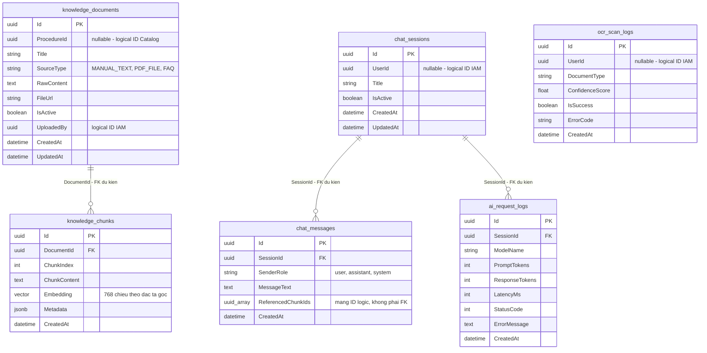

| Bảng dự kiến | Dùng để làm gì | Nhóm task liên quan |
| --- | --- | --- |
| knowledge_documents | Lưu tài liệu nguồn cho hỏi đáp, liên kết thủ tục khi có | Knowledge Base và Chunking |
| knowledge_chunks | Lưu đoạn văn, metadata và embedding phục vụ tìm kiếm ngữ nghĩa | Chunking, Vector Search, Gemini RAG |
| chat_sessions | Gom hội thoại của công dân thành phiên | Gemini RAG |
| chat_messages | Lưu câu hỏi, câu trả lời và nguồn đã tham khảo | Gemini RAG |
| ai_request_logs | Theo dõi model, token, thời gian và lỗi của lượt gọi AI | Gemini RAG và vận hành AI |
| ocr_scan_logs | Theo dõi kết quả quét CCCD/tài liệu, không thay thế hồ sơ người dùng | Pipeline OCR CCCD |

Các điểm thiết kế cần xử lý khi triển khai, **chưa phải ràng buộc đã chạy**:

- FK `knowledge_chunks.DocumentId` dự kiến cascade khi xóa tài liệu theo đặc tả. HNSW dự kiến áp dụng cho embedding; kích thước vector phải khớp model embedding được chọn, không suy ra từ model Gemini sinh văn bản.
- `ReferencedChunkIds` là mảng UUID: PostgreSQL không tự kiểm tra FK từng phần tử. Nếu cần toàn vẹn tham chiếu và nhiều metadata cho citation, có thể thay bằng bảng nối riêng trong task RAG; bảng nối đó chưa tính trong tổng 42.
- Đặc tả đặt `ai_request_logs.SessionId` bắt buộc. Nếu dùng bảng này để ghi cả lần bóc tách PDF không thuộc chat, phải cho phép nullable hoặc mở rộng loại request; sơ đồ hiện giữ nguyên phạm vi log chat của đặc tả.
- OCR log chỉ lưu metadata kết quả trong thiết kế này. Chưa thiết kế bảng lưu toàn bộ thông tin CCCD; không mặc định sao chép ảnh/số CCCD vào log.
- Quản lý quyền truy cập phiên chat, thời hạn giữ dữ liệu, xóa embedding khi tài liệu ngừng hiệu lực và lọc nguồn RAG còn cần triển khai.

### 6.3. AnalyticsSystem — ERD đích gồm 3 bảng hiện tại và 8 bảng tương lai

`notifications`, `notification_inbox`, `notification_deliveries` đã có (chi tiết mục 1.5). **Tám bảng còn lại trong sơ đồ là dự kiến**. Không tạo FK vật lý đến IAM, Workflow hoặc Catalog.

```mermaid
erDiagram
    notifications ||--o{ notification_deliveries : "NotificationId - FK da co"
    notifications {
        uuid Id PK
        uuid RecipientUserId "IAM logical ID - DA CO"
        uuid ApplicationId "nullable - Workflow logical ID"
        uuid SourceEventId "nullable"
        boolean IsRead
    }
    notification_deliveries {
        uuid Id PK
        uuid NotificationId FK
        string Channel "DA CO"
        string State
    }
    notification_inbox {
        uuid Id PK "event ID - DA CO"
        jsonb Payload
        string State
    }
    approved_qrs {
        uuid Id PK "DU KIEN"
        uuid ApplicationId UK "Workflow logical ID"
        string QrCodeUrl
        string GeneratedPdfUrl
        datetime CreatedAt
    }
    citizen_feedback {
        uuid Id PK "DU KIEN"
        uuid ApplicationId UK "Workflow logical ID"
        uuid CitizenId "IAM logical ID"
        int Rating "du kien 1 den 5"
        text Comment
        datetime CreatedAt
    }
    daily_performance_metrics {
        uuid Id PK "DU KIEN"
        uuid OfficerId "IAM logical ID"
        date MetricDate "unique cung OfficerId"
        int TotalProcessed
        int ApprovedCount
        int RevisionRequestedCount
        float AverageProcessingTimeMinutes
        datetime UpdatedAt
    }
    application_procedure_metrics {
        uuid Id PK "DU KIEN"
        uuid ProcedureId "Catalog logical ID"
        date MetricDate "unique cung ProcedureId"
        int TotalApplications
        int ApprovedCount
        int RejectedOrCancelledCount
        int ResubmittedCount
        datetime UpdatedAt
    }
    audit_logs {
        uuid Id PK "DU KIEN"
        uuid UserId "nullable - IAM logical ID"
        string Action
        string EntityName
        string EntityId
        jsonb Details
        string IpAddress
        datetime CreatedAt
    }
    system_settings {
        int Id PK "DU KIEN"
        string SettingKey UK
        text SettingValue
        text Description
        uuid UpdatedBy "IAM logical ID"
        datetime UpdatedAt
    }
    service_health_logs {
        uuid Id PK "DU KIEN"
        string ServiceName
        string Status
        int LatencyMs
        text Message
        datetime CheckedAt
    }
    system_backup_logs {
        uuid Id PK "DU KIEN"
        string BackupType
        string FileName
        bigint FileSizeBytes
        string StorageLocation
        string Status
        text ErrorMessage
        datetime CreatedAt
    }
```

| Bảng tương lai | Chức năng cần bổ sung |
| --- | --- |
| approved_qrs | Sinh và quản lý mã QR tra cứu hồ sơ đã duyệt, liên kết PDF kết quả |
| citizen_feedback | Công dân đánh giá chất lượng phục vụ theo hồ sơ |
| daily_performance_metrics | Worker tổng hợp năng suất theo cán bộ/ngày |
| application_procedure_metrics | Worker tổng hợp số liệu theo thủ tục/ngày |
| audit_logs | Nhật ký thao tác toàn hệ thống, khác rbac_audit_logs riêng của IAM |
| system_settings | Cấu hình nghiệp vụ dùng chung; không dùng để lưu secret dạng rõ |
| service_health_logs | Lưu lịch sử kiểm tra sức khỏe; endpoint health hiện có không đồng nghĩa đã có bảng này |
| system_backup_logs | Theo dõi backup; bảng log không tự tạo chức năng sao lưu hay phục hồi |

Các điểm cần hoàn thiện trước khi triển khai:

- Thiết kế metrics gốc chưa có `WardCode`. Dashboard Manager theo phường cần bổ sung chiều phường và grain/index tương ứng, hoặc nguồn dữ liệu lịch sử bảo toàn phường tại thời điểm xử lý. Không chỉ tra phường hiện tại của cán bộ vì cán bộ có thể chuyển công tác.
- `approved_qrs.ApplicationId` và `citizen_feedback.ApplicationId` unique theo đặc tả. Quyền đánh giá, thời điểm cho phép đánh giá và dữ liệu công khai khi quét QR còn phải được định nghĩa trong task tương ứng.
- Một hồ sơ có thể có nhiều GeneratedDocument trong code hiện tại, trong khi approved_qrs chỉ có một GeneratedPdfUrl theo đặc tả gốc. Cần chốt PDF tổng hợp hay trang tra cứu liệt kê tài liệu; chưa giả định một PDF đại diện chứa tất cả biểu mẫu.
- Trạng thái metrics `RejectedOrCancelledCount` không có nghĩa API hủy hồ sơ đã tồn tại.
- Không thêm lại các trường retry vào notifications một cách trùng lặp: implementation hiện tại đã tách việc gửi sang notification_deliveries. Receipt từ nhà cung cấp, external message ID và trạng thái delivered cần đối chiếu adapter khi triển khai Email/SMS thật.
- Đường dẫn backup, audit và cấu hình cần kiểm soát quyền/ẩn dữ liệu nhạy cảm; đây là lưu ý thiết kế tương lai, không phải xác nhận các checks đã có.

### 6.4. Bản đồ ERD logic đích — đủ 6 service

Các khối ghi “DỰ KIẾN” chưa có mapping/migration. Tất cả mũi tên giữa các service là **liên kết logic hoặc sự kiện**, không phải FK. Quan hệ FK nội bộ xem ERD chi tiết ở trên.

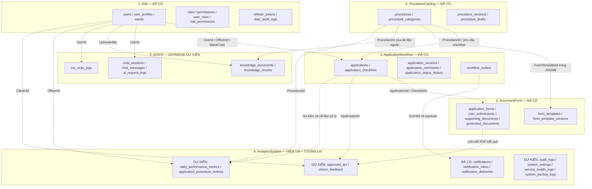

### 6.5. Lịch sử cập nhật

- 15/10/2026: bổ sung ERD tương lai từ đặc tả gốc cho 6 bảng AIOCR và 8 bảng AnalyticsSystem; thêm bảng đối chiếu 28 hiện có / 14 dự kiến và bản đồ đủ 6 service. Không tạo bảng, migration hoặc API trong lần cập nhật tài liệu này.

## 7. Activity, State Machine và Structure Analysis toàn hệ thống đích

Xem [**Bộ luồng và cấu trúc đích cho cả 6 service**](system-future-flows.md). Tách sang file này để tài liệu hiện tại không quá dài; đây là phần tiếp nối của cùng bộ sơ đồ, không thay thế các sơ đồ hiện trạng ở mục 2–4.

Bộ bổ sung có ma trận trạng thái từng service, 9 Activity Diagram, 10 State Machine và 4 sơ đồ Structure Analysis. Mỗi phần phân biệt **[CÓ]**, **[MỘT PHẦN]**, **[DỰ KIẾN]**; trạng thái đề xuất không phải enum đã được thêm vào code.

## 8. ERD hợp nhất — 42 bảng trong cùng một sơ đồ

Xem [**ERD tổng thể toàn hệ thống**](system-unified-erd.md). Sơ đồ nối ở cấp bảng, bao gồm 28 bảng hiện tại và 14 bảng dự kiến. Mỗi bảng có tiền tố service; mỗi cạnh ghi FK, FK_FUTURE, REF hoặc REF_FUTURE. Hai bảng log vận hành không có khóa tham chiếu được giữ độc lập đúng đặc tả, không tạo quan hệ giả để ép mọi bảng phải nối.

Các ERD riêng ở mục 1 và mục 6 được giữ nguyên để xem chi tiết.
