# WardMate — Sơ đồ phân tích hệ thống

ERD đã cập nhật 24/10/2026: [Conceptual](system-erd-conceptual.md), [Logical hợp nhất](system-unified-erd.md), [Physical đầy đủ](system-erd-physical.md), [ERD tương tác 3 mức](diagrams/erd/wardmate-erd-interactive.html), [draw.io tiếng Anh](diagrams/erd/wardmate-erd-en.drawio). Có 41 bảng EF ứng dụng của 6 service; 6 bảng tương lai tách riêng. Chỉ đối chiếu source, không xác nhận Azure.

Các mục Activity/State/Structure bên dưới giữ nguyên từbộtrước, không thuộc lượt cậpnhậtERD này; không dùng thôngtin lịchsử ở đó để phủđịnh ERD mới. [Bản cũ đầyđủ](diagrams/erd/archive-system-diagrams-20261015.md).

## 1. ERD — ba trang toàn hệ thống

[Conceptual](system-erd-conceptual.md) · [Logical](system-unified-erd.md) · [Physical](system-erd-physical.md) · [File draw.io 3 trang](diagrams/erd/wardmate-erd.drawio). Mỗi trang nối toàn bộ 6 service. 41 bảng hiện có; 6 bảng FUTURE được đánh dấu riêng trong cùng hình. Bản tương tác: [wardmate-erd-interactive.html](diagrams/erd/wardmate-erd-interactive.html); draw.io tiếng Anh: [wardmate-erd-en.drawio](diagrams/erd/wardmate-erd-en.drawio).

## 2. Activity Diagram — Luồng hoạt động

Đã bổ sung [**bản vẽ UML tiếng Anh theo ảnh mẫu**](diagrams/activities/index.html), [file draw.io chỉnh sửa được](diagrams/activities/wardmate-activities.drawio) và [Mermaid source](diagrams/activities/README.md). Các bản phân tích hiện trạng bên dưới được giữ nguyên để đối chiếu nghiệp vụ.

Các sơ đồ dùng flowchart Mermaid để biểu diễn hoạt động, điểm quyết định và vùng trách nhiệm; không phải bản xuất UML/XMI.

### 2.1. PDF → đối soát → thủ tục chính thức

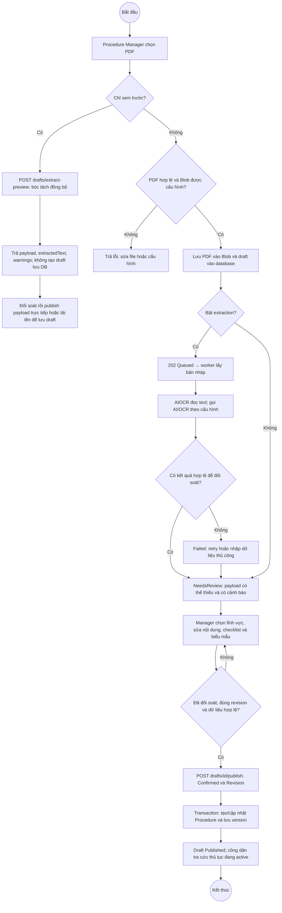

Không tự xuất bản kết quả AI. Nhánh preview không tự tạo `draftId`; không dùng ID tưởng tượng để gọi draft publish. `POST procedures/publish` là luồng nhận payload đã đối soát trực tiếp, khác với publish draft đã lưu.

### 2.2. Prepare Documents and Visit Ward Office — thiết kế mới

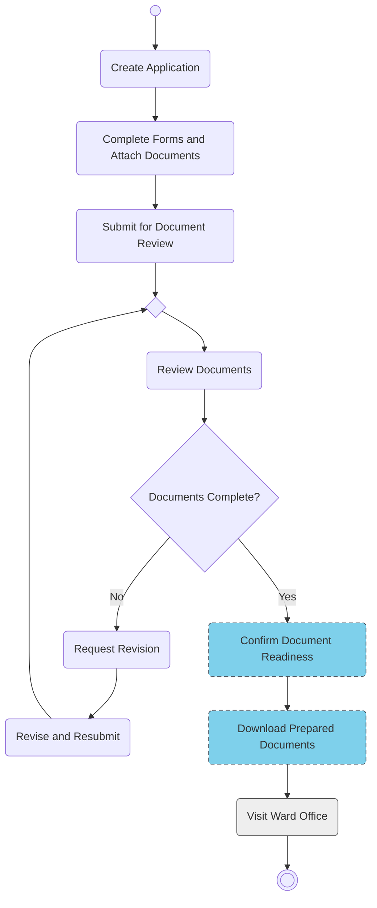

Nhánh No yêu cầu sửa/bổ sung rồi kiểm tra lại; không phải từ chối giải quyết. Nhánh Yes chỉ xác nhận giấy tờ sẵn sàng. Visit Ward Office là hành động ngoài hệ thống.

### 2.3. Thông báo bất đồng bộ

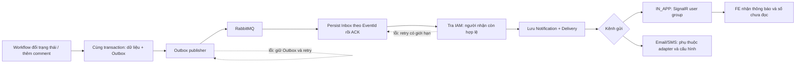

Email/SMS thật chưa được coi là hoàn tất. Event ID và unique index chống xử lý trùng ở mức lưu dữ liệu; không khẳng định toàn hệ thống gửi đúng một lần tuyệt đối.

## 3. State Machine — Vòng đời

### 3.1. Application — trạng thái đề xuất cho kiểm tra giấy tờ

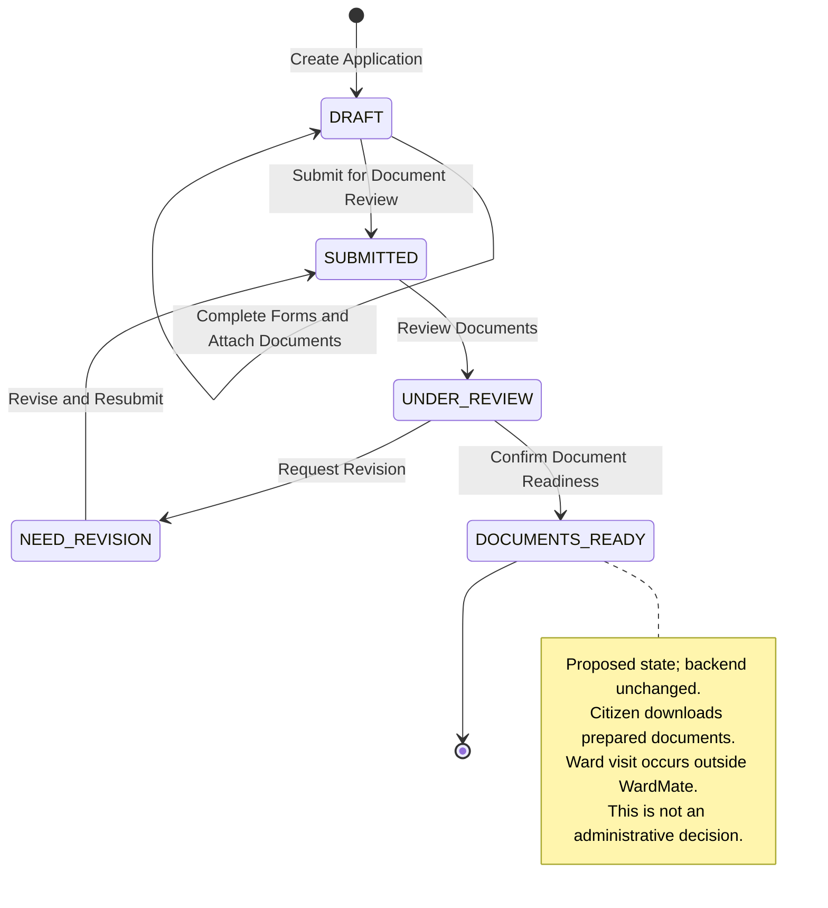

### 3.2. ProcedureDraft — bản nháp bóc tách PDF

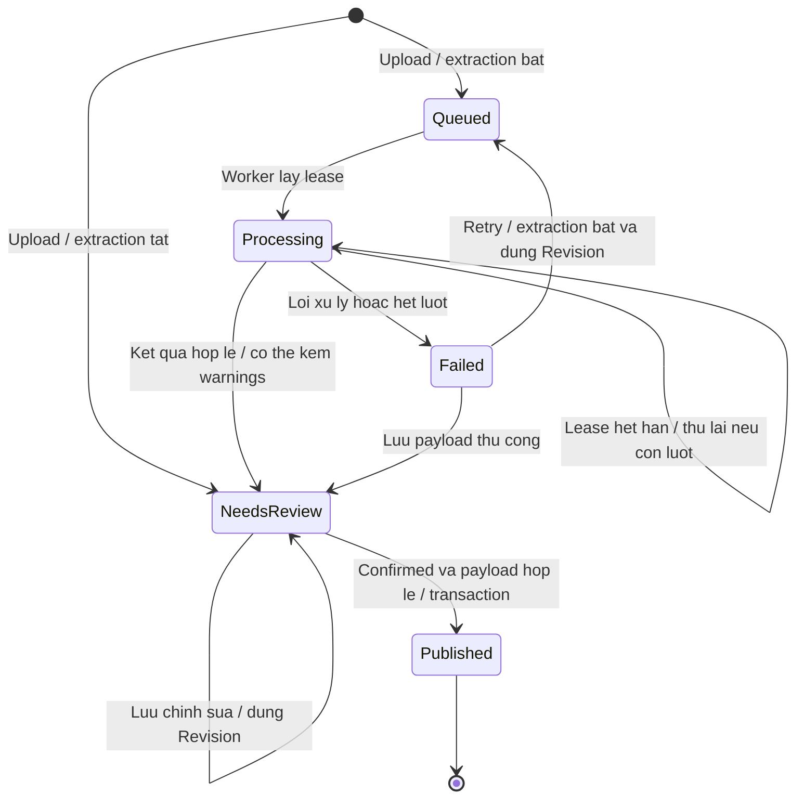

Worker dùng lease để tránh nhiều worker ghi cùng draft; tối đa 3 lần nhận xử lý trong chu kỳ trước khi `Failed`. Retry thủ công reset số lần. Preview đồng bộ không đi qua state machine này.

### 3.3. UserSubmission — biểu mẫu chuẩn bị, thiết kế mới

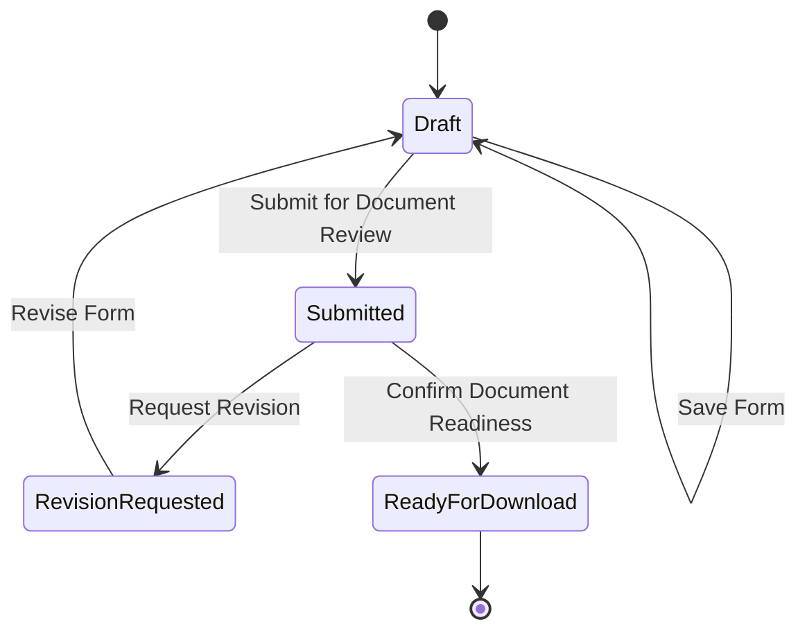

Đây là vòng đời đề xuất của biểu mẫu, không phải quyết định hành chính. Cơ chế đồng bộ và điều kiện PDF hiện tại vẫn còn dùng trạng thái cũ; sẽ sửa code ở task sau.

## 4. Structure Analysis — Phân tích cấu trúc

Ở đây “Structure Analysis” gồm phân rã chức năng (FDD), kiến trúc service và sơ đồ dòng dữ liệu (DFD). DFD là mô hình phân tích, không phải sơ đồ gọi HTTP chi tiết từng endpoint.

### 4.1. Phân rã chức năng

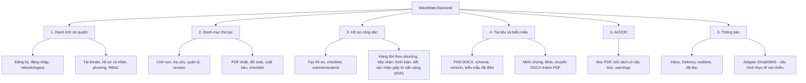

Tên service `AnalyticsSystem` hiện không tự chứng minh đã có đầy đủ dashboard, báo cáo hay Knowledge Base/RAG. Các chức năng đó không được thêm vào sơ đồ như phần đã hoàn thành.

### 4.2. Kiến trúc service và hạ tầng

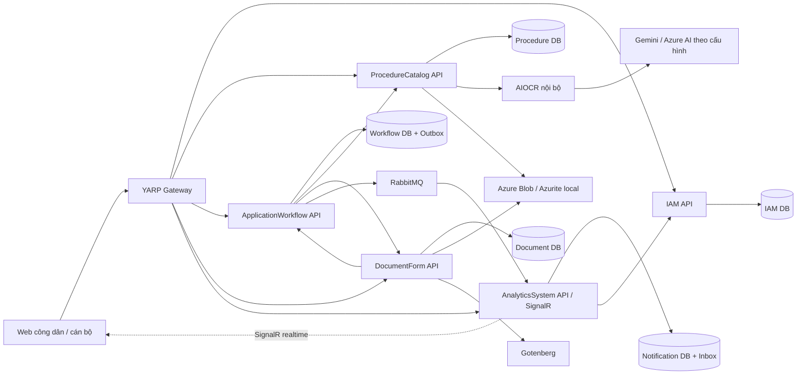

Đây là kiến trúc logic; URL và đường route cụ thể tùy cấu hình local/Azure. Các service không truy vấn trực tiếp database của nhau. JWT bảo vệ API người dùng; các lời gọi nội bộ dùng cơ chế xác thực nội bộ theo cấu hình. Không suy ra service đã deploy từ việc nó có mặt trong sơ đồ.

### 4.3. Clean Architecture — chiều phụ thuộc mã nguồn

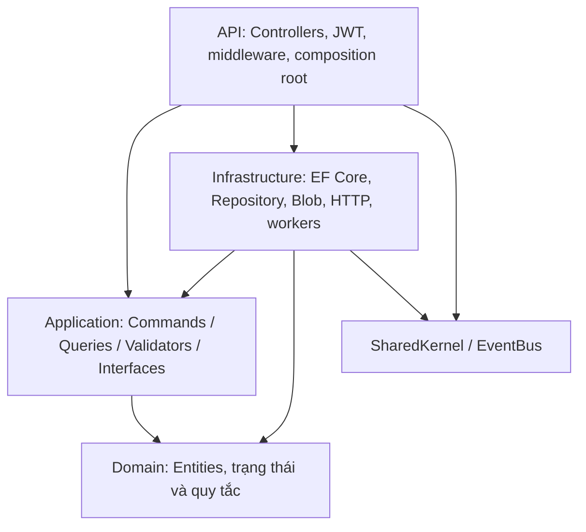

Mũi tên biểu diễn phụ thuộc, không phải thứ tự xử lý request. API đăng ký implementation Infrastructure vào DI; Application gọi qua interface. Cách tổ chức file chi tiết khác nhau giữa các service, sơ đồ mô tả ranh giới trách nhiệm chung.

### 4.4. DFD mức ngữ cảnh

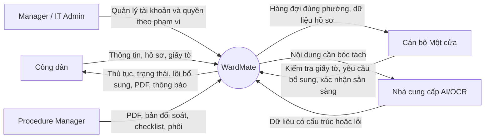

### 4.5. DFD mức 1 — xử lý hồ sơ

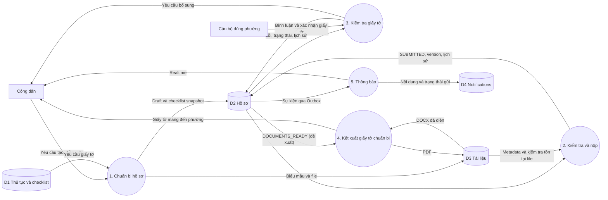

## 5. Nguồn đối chiếu và giới hạn

- IAM: `src/Services/WardMate.Services.IAM/WardMate.Services.IAM.Domain/Entities/` và `WardMate.Services.IAM.Infrastructure/Persistence/Configurations/`.
- Catalog: `src/Services/WardMate.Services.ProcedureCatalog/WardMate.Services.ProcedureCatalog.Domain/Entities/`, `Application/Drafts/ProcedureDraftService.cs` trong project Application và `Infrastructure/Drafts/DraftExtractionWorker.cs` trong project Infrastructure.
- Workflow: `src/Services/WardMate.Services.ApplicationWorkflow/WardMate.Services.ApplicationWorkflow.Domain/`, project Application: `WorkflowRequests.cs`, `ReviewHandlers.cs`, `FinalDecisionRequests.cs`; project Infrastructure: `WorkflowDbContext.cs`, `WorkflowOutbox.cs`.
- DocumentForm: `src/Services/WardMate.Services.DocumentForm/WardMate.Services.DocumentForm.Domain/Entities/`, project Infrastructure: `Persistence/Configurations/`; project API: `Security/ApplicationAccess.cs`.
- Notifications: `src/Services/WardMate.Services.AnalyticsSystem/WardMate.Services.AnalyticsSystem.Infrastructure/NotificationDbContext.cs` và các worker cùng service.
- Hướng dẫn sử dụng và quy tắc chi tiết: [API guide](api-guide.md), [System constraints](system-constraints.md), [Progress](../PROGRESS.md).

Tài liệu không xác nhận độ chính xác tuyệt đối của AI, giao dịch nguyên tử xuyên service, gửi thông báo exactly-once, SMS/Email production, hay kiểm thử toàn luồng Azure. Khi bổ sung entity, FK hoặc chuyển trạng thái mới, cần sửa sơ đồ tương ứng thay vì coi sơ đồ này là đặc tả bất biến.

## 6. ERD tương lai

6 bảng chưa triển khai được giữ riêng trong [Logical ERD](system-unified-erd.md). Chat, Knowledge Base, metrics, feedback và QR đã có, không còn thuộc phần tương lai. Xem bản lưu lịch sử nếu cần thiết kế trước đây.

## 7. Activity, State Machine và Structure Analysis

Xem [bộ sơ đồ luồng](system-future-flows.md); phần này không thay đổi trong lượt cập nhật ERD.

## 8. ERD hợp nhất

[41 bảng hiện có và 6 bảng tương lai](system-unified-erd.md); FK vật lý và REF logic được phân biệt.
