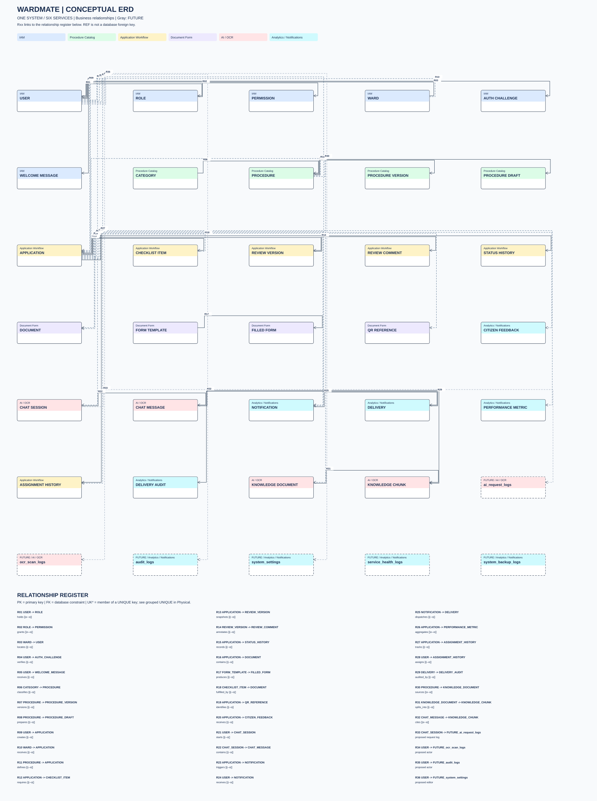

# WardMate — Conceptual ERD

Cập nhật 24/10/2026 (UTC+07:00). Bản tương tác và draw.io tiếng Anh: [wardmate-erd-interactive.html](diagrams/erd/wardmate-erd-interactive.html), [wardmate-erd-en.drawio](diagrams/erd/wardmate-erd-en.drawio).

Mỗi trang chứa toàn bộ 6 service và các quan hệ xuyên service. Nét liền là FK thật; nét đứt là REF logic, không phải FK xuyên database. Các ô FUTURE là 6 bảng dự kiến, chưa có schema triển khai. R01… đối chiếu danh mục quan hệ ngay dưới mỗi hình.

Khái niệm nghiệp vụ; không biểu diễn từng cột SQL. DOCUMENT là khái niệm gom tài liệu, không phải một bảng duy nhất.

[ Mở hình SVG để phóng to ](diagrams/erd/conceptual.svg) · [File draw.io — chọn trang Conceptual](diagrams/erd/wardmate-erd.drawio)

Nguồn: [EF model inventory](diagrams/erd/model-inventory.json). [DDL đầy đủ](diagrams/erd/schema/) giữ default, index, CHECK và ON DELETE; đây là script CREATE để tham khảo, không chạy lên DB hiện hữu. Sơ đồ đối chiếu source, không xác nhận migration trên Azure. Không tạo bảng hay sửa code backend trong lượt này.
