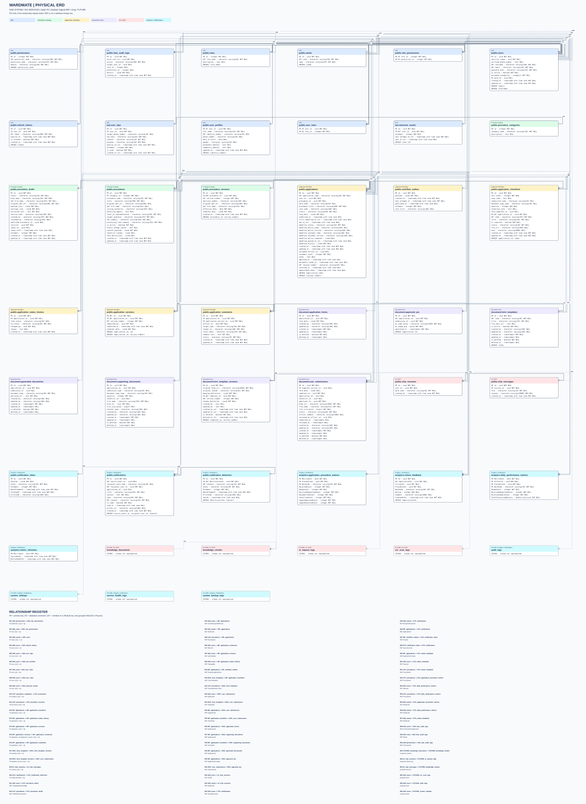

# WardMate — Physical ERD

Cập nhật 23/10/2026 (UTC+07:00).

Mỗi trang chứa toàn bộ 6 service và các quan hệ xuyên service. Nét liền là FK thật; nét đứt là REF logic, không phải FK xuyên database. Các ô FUTURE là 8 bảng dự kiến, chưa có schema triển khai. R01… đối chiếu danh mục quan hệ ngay dưới mỗi hình.

37 bảng hiện có, 343 cột, 20 FK thật và 40 nhóm REF. Hiển thị tên SQL, kiểu dữ liệu, NULL/NOT NULL, PK/FK và UNIQUE ghép. UK* chỉ thành viên của khóa UNIQUE, không có nghĩa mỗi cột riêng lẻ là unique.

[ Mở hình SVG để phóng to ](diagrams/erd/physical.svg) · [File draw.io — chọn trang Physical](diagrams/erd/wardmate-erd.drawio)

Nguồn: [EF model inventory](diagrams/erd/model-inventory.json). [DDL đầy đủ](diagrams/erd/schema/) giữ default, index, CHECK và ON DELETE; đây là script CREATE để tham khảo, không chạy lên DB hiện hữu. Sơ đồ đối chiếu source, không xác nhận migration trên Azure. Không tạo bảng hay sửa code backend trong lượt này.
