# WardMate — Luồng hoạt động và cấu trúc đích của 6 service

> Cập nhật triển khai local 16/10/2026: luồng xác nhận giấy tờ đã được code bằng DOCUMENTS_READY/documentsReadyAt và submission ReadyForDownload. Các ảnh xuất ngày 15/10 là bản thiết kế tại thời điểm đó; nhãn “backend pending” trong ảnh đã được thay thế bởi cập nhật này. Chưa deploy/migrate Azure cho thay đổi mới. ERD cũ vẫn giữ để đối chiếu; migration DocumentReadiness bổ sung documents_ready_at.

> **Điều chỉnh phạm vi ngày 15/10/2026:** WardMate hỗ trợ chuẩn bị và kiểm tra giấy tờ trước khi đến phường; không phê duyệt hoặc từ chối giải quyết hồ sơ hành chính. Các sơ đồ Application/Document/QR dưới đây là thiết kế mới, **chưa triển khai vào backend**. `DOCUMENTS_READY` và `ReadyForDownload` là tên trạng thái đề xuất, chưa phải giá trị API. ERD được giữ nguyên để đối chiếu: các cột/trạng thái APPROVED, REJECTED, ApprovedAt và thiết kế approved_qrs/metrics cũ không có nghĩa còn thuộc phạm vi nghiệp vụ đích. Việc giải quyết chính thức tại phường nằm ngoài hệ thống.


Cập nhật: 15/10/2026, Asia/Saigon (UTC+07:00).

Phần tiếp nối của [ERD và sơ đồ hiện trạng](system-diagrams.md). Dựa trên source đang có, đặc tả 35 bảng ban đầu và danh sách công việc của chủ dự án. Đây là **thiết kế đích**, không phải xác nhận toàn hệ thống đã deploy hoặc chạy tích hợp thành công.

## 1. Cách đọc và phạm vi

- **[CÓ]**: đã có code thực hiện trách nhiệm mô tả, không đồng nghĩa đã kiểm thử production.
- **[MỘT PHẦN]**: có nền tảng/adapter nhưng còn thiếu tích hợp, cấu hình thật hoặc chức năng cần thiết.
- **[DỰ KIẾN]**: chưa triển khai; quy tắc và trạng thái là đề xuất để hiện thực đặc tả.
- Trong sơ đồ trộn hiện tại/tương lai, nhãn chữ là nguồn phân biệt chính; không phụ thuộc màu.
- Mũi tên trong Activity là thứ tự hoạt động; trong DFD là dữ liệu; trong sơ đồ phụ thuộc là phụ thuộc thành phần. Không dùng chúng như FK.
- Activity được trình bày bằng flowchart Mermaid, có quyết định và nhánh lỗi; không phải tài liệu UML/XMI xuất từ công cụ CASE.
- Tên trạng thái ở các State Machine tương lai là tên phân tích. Chưa tạo cột `Status`, enum, migration hoặc endpoint từ các tên này.

| Service | [CÓ] | [MỘT PHẦN] / [DỰ KIẾN] |
| --- | --- | --- |
| 1. IAM | Đăng ký/đăng nhập, BCrypt, JWT, refresh rotation, cookie/CSRF, profile, account, phường, RBAC và audit RBAC | Đồng bộ audit tập trung và cache quyền phân tán theo thiết kế tổng thể; không coi JWT đang lưu ở client tự mất hiệu lực ngay khi đổi quyền |
| 2. ProcedureCatalog | Lĩnh vực, tra cứu, version, trạng thái active, checklist, PDF draft, preview, đối soát, publish | Đồng bộ phiên bản thủ tục sang Knowledge Base; bóc tách tài liệu dài theo mục nghiệp vụ chưa hoàn thiện |
| 3. ApplicationWorkflow | Code cũ (chờ sửa): DRAFT → SUBMITTED → UNDER_REVIEW → NEED_REVISION/APPROVED/REJECTED, snapshot, diff, bình luận, scope phường, Outbox | Thay approval/rejection bằng xác nhận giấy tờ sẵn sàng; sửa đồng bộ PDF, sự kiện và metrics theo phạm vi mới |
| 4. DocumentForm | Phôi/version/schema, DOCX, biểu mẫu đã điền, minh chứng, Blob, kiểm tra quyền, kết xuất PDF qua Gotenberg | Sửa điều kiện kết xuất sang readiness; QR tham chiếu giấy tờ chuẩn bị là tùy chọn tương lai |
| 5. AIOCR | Đọc lớp text PDF, AI có schema/kiểm tra kết quả, retry có giới hạn, cảnh báo; nhánh OCR PDF theo cấu hình | OCR PDF cần nhà cung cấp cấu hình thật; chưa có KB/chunk/vector/RAG/chat database và pipeline OCR CCCD |
| 6. AnalyticsSystem | Notifications, Inbox/Delivery, SignalR user/ward, đã đọc, guard quyền/kết nối | Email có adapter chưa xác nhận gửi thật, SMS chưa có nhà cung cấp; QR, feedback, metrics/dashboard, audit/settings, health history/backup chưa triển khai |

Các hướng mới như MFA, thanh toán, ký số có giá trị pháp lý đầy đủ hoặc tích hợp định danh quốc gia không tự được coi là phạm vi đã chốt chỉ vì cần cho một hệ thống hoàn chỉnh.

## 2. Activity Diagram — Các luồng đích

**Bản vẽ tiếng Anh theo ký hiệu UML của ảnh mẫu:** [mở thư viện offline](diagrams/activities/index.html), [file draw.io 9 trang chỉnh sửa được](diagrams/activities/wardmate-activities.drawio), hoặc [chọn mã Mermaid từng luồng](diagrams/activities/README.md). Nhãn hành động chỉ dùng cụm động từ ngắn; viền nét đứt thể hiện phần dự kiến, viền vàng thể hiện phần mới có một phần. Các biểu đồ dưới đây giữ lại phần phân tích chi tiết bằng tiếng Việt.

### 2.1. IAM — Xác thực và quản lý tài khoản

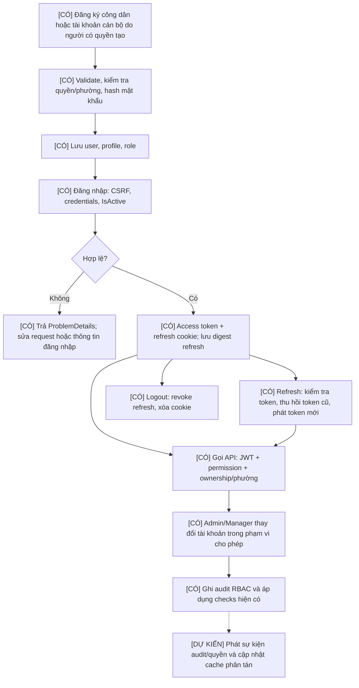

Không vẽ cache phân tán như đã có chỉ vì Docker có Redis. Cần thiết kế TTL/invalidation và xác định API nào kiểm tra quyền mới nhất; token cũ có thể còn claims cũ. Không tự mở rộng quyền Manager ra ngoài Front Desk thuộc phường được quản lý.

### 2.2. ProcedureCatalog — Xuất bản và đồng bộ dữ liệu tra cứu AI

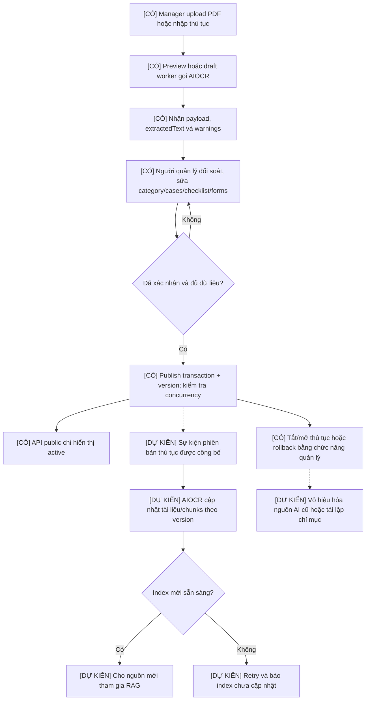

Sự kiện Catalog → AIOCR chưa phải một integration event đã có. Việc publish thủ tục không nên bị báo thành công về RAG trước khi index thực sự cập nhật. Thiết kế nguồn RAG cần tránh trả thủ tục đã tắt hoặc phiên bản hết hiệu lực.

### 2.3. ApplicationWorkflow — Prepare Documents for Ward Visit

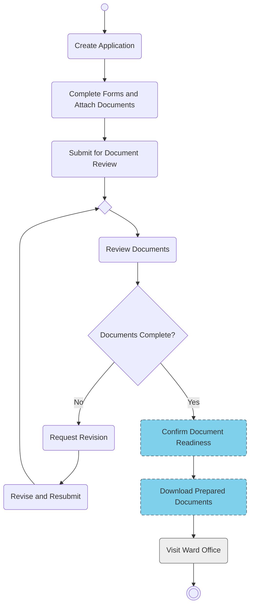

### 2.4. DocumentForm — Prepare Documents (luồng đích)

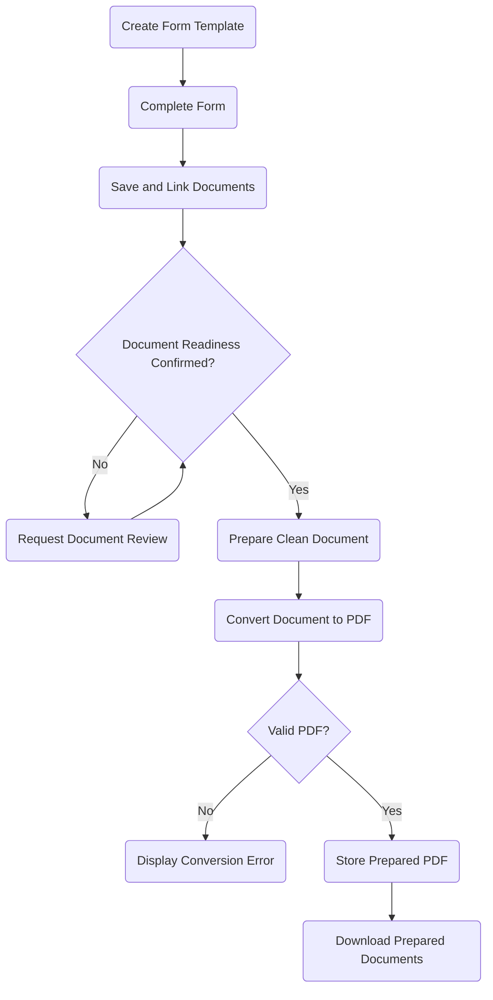

Điều kiện readiness thay thế approval là đề xuất chưa code. PDF là giấy tờ đã chuẩn bị để mang đến phường, không phải văn bản giải quyết hoặc được đóng dấu pháp lý. QR tham chiếu là tùy chọn tương lai, không bắt buộc để tải PDF.

### 2.5. AIOCR — Nạp tri thức và hỏi đáp RAG

**Toàn bộ luồng này [DỰ KIẾN].** Không phải pipeline đọc PDF thủ tục đang chạy.

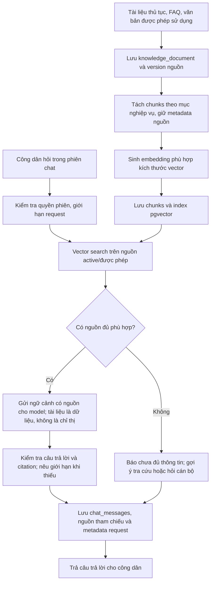

Chatbot chỉ tư vấn, không tự sửa quyền hay duyệt hồ sơ. Không dùng embedding model name/dimension trong đặc tả cũ như lựa chọn triển khai mặc định mà chưa kiểm tra cấu hình thực tế.

### 2.6. AIOCR — OCR CCCD và hỗ trợ điền hồ sơ

**Toàn bộ pipeline CCCD này [DỰ KIẾN].** OCR fallback cho PDF đã có code riêng, không chứng minh các bước dưới đây đã có.

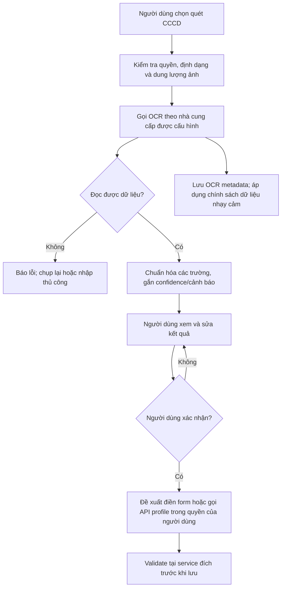

Không tự cập nhật IAM chỉ vì OCR trả confidence cao. Việc lưu ảnh, giữ dữ liệu bao lâu và dọn dữ liệu sau xử lý phải chốt khi triển khai; ocr_scan_logs không mặc định lưu nguyên văn CCCD.

### 2.7. AnalyticsSystem — Thông báo đa kênh

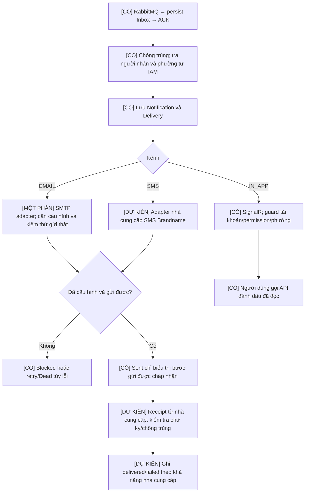

Zalo ZNS có trong giá trị kênh của đặc tả ban đầu nhưng chưa có task tích hợp được chốt; không coi là kênh gửi đã hỗ trợ. Không suy ra người dùng đọc email/SMS từ trạng thái Sent/Delivered.

### 2.8. AnalyticsSystem — Preparation Reference, Feedback and Metrics [DỰ KIẾN]

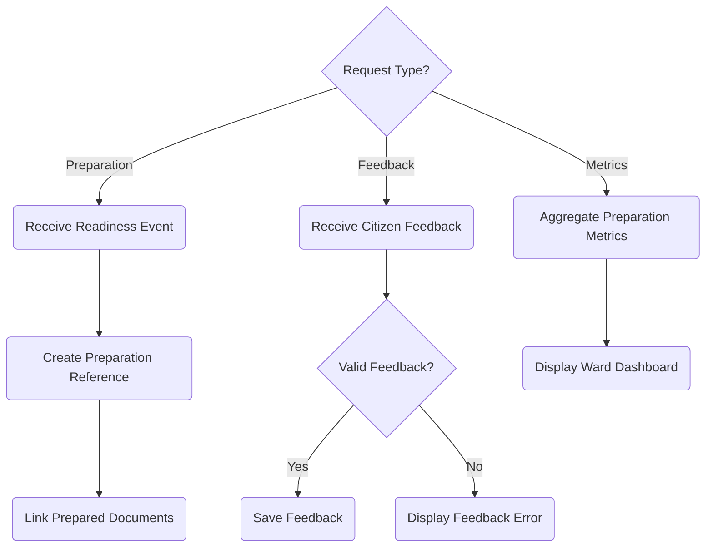

QR chỉ tham chiếu bộ giấy tờ đã chuẩn bị; không xác nhận kết quả hành chính. Ba nhánh là các job/yêu cầu độc lập.

### 2.9. AnalyticsSystem — Audit, cấu hình, health và backup

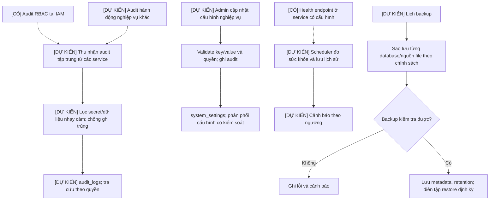

Secret tiếp tục thuộc cơ chế secrets của môi trường, không đặt vào system_settings dạng rõ. Có file backup không chứng minh restore thành công. Audit logs không thay thế application logs/traces; health không thay thế kiểm thử nghiệp vụ.

## 3. State Machine — Hiện tại và trạng thái đề xuất

### 3.1. IAM — Tài khoản và refresh token [CÓ]

Hai vùng mô tả hai đối tượng khác nhau. `Expired` là điều kiện theo thời gian, không phải enum/cột status của refresh_tokens. Tương lai cache/audit phân tán không yêu cầu tự thêm trạng thái tài khoản mới.

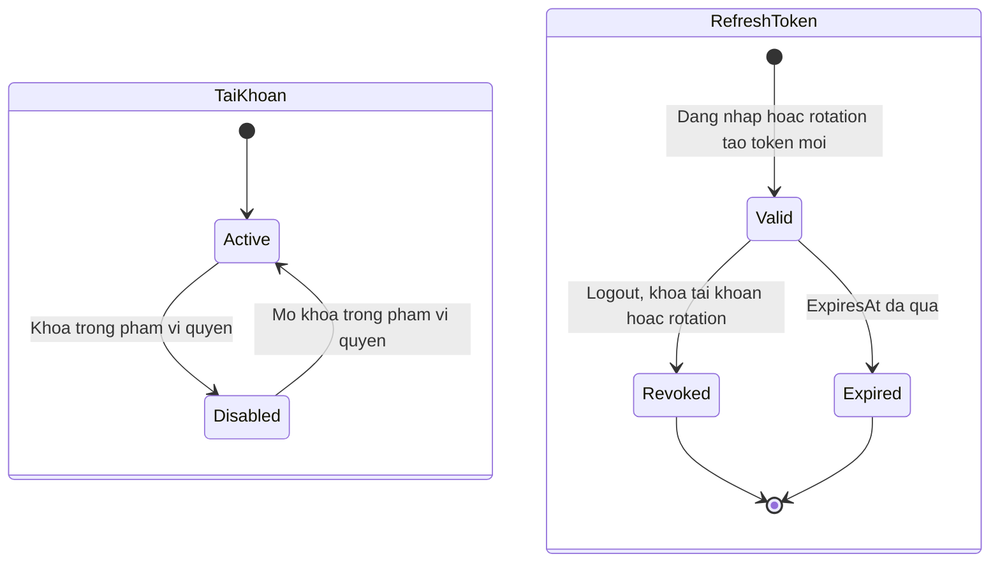

Mở khóa không khôi phục token đã revoke. Access token là đối tượng khác và có vòng đời hết hạn riêng.

### 3.2. ProcedureCatalog — Công bố và trạng thái index tương lai

Vòng đời draft đã có xem [mục 3.2 hiện trạng](system-diagrams.md#32-proceduredraft--bản-nháp-bóc-tách-pdf). `IsActive` và trạng thái index là hai chiều riêng, không thay thế nhau.

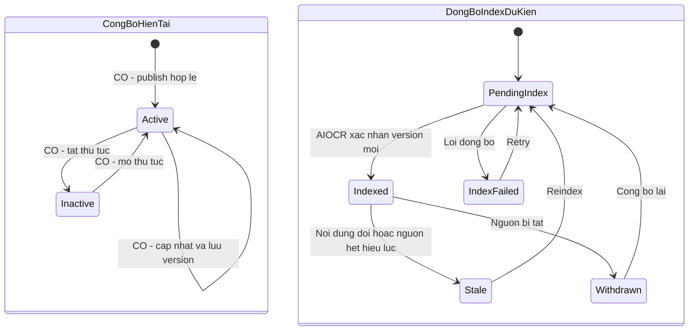

Trạng thái index là đề xuất projection/job, chưa quyết định lưu tại bảng nào. Không thêm vào `procedures.Status` như thể code đã có cột này.

### 3.3. ApplicationWorkflow — trạng thái đích, chờ sửa code

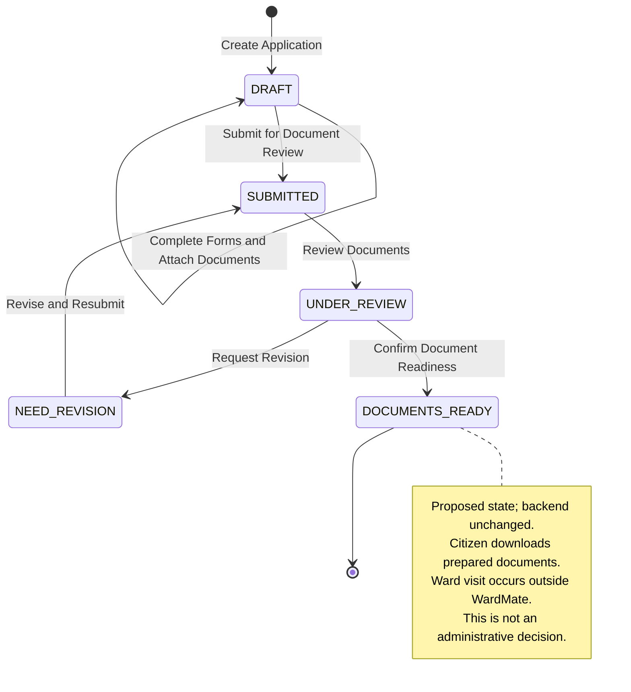

### 3.4. DocumentForm — Prepared PDF Job [DỰ KIẾN]

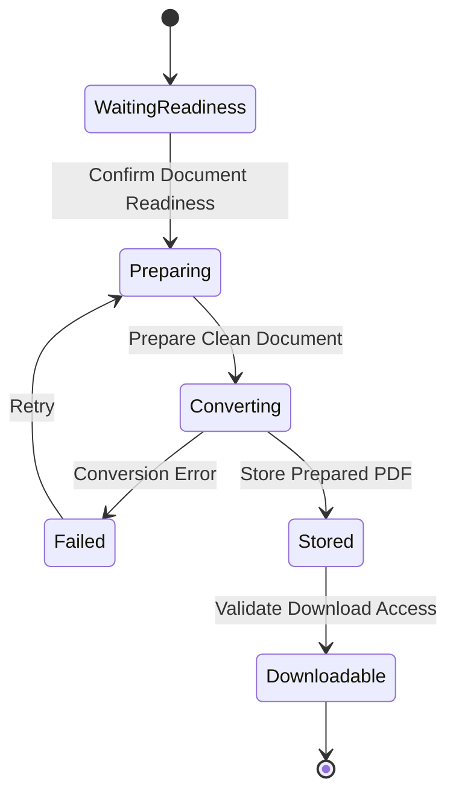

### 3.5. AIOCR — Knowledge Document và indexing [DỰ KIẾN]

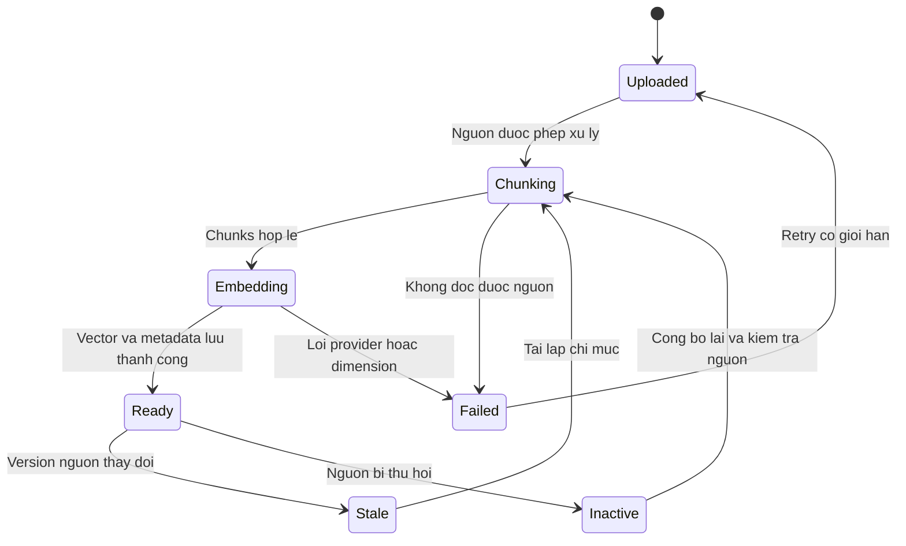

`IsActive` trong ERD gốc chưa đủ để lưu toàn bộ trạng thái xử lý này. Cần thêm metadata trạng thái/job ở task triển khai; không coi ERD gốc đã biểu diễn đầy đủ state machine mới.

### 3.6. AIOCR — Lượt hỏi đáp RAG [DỰ KIẾN]

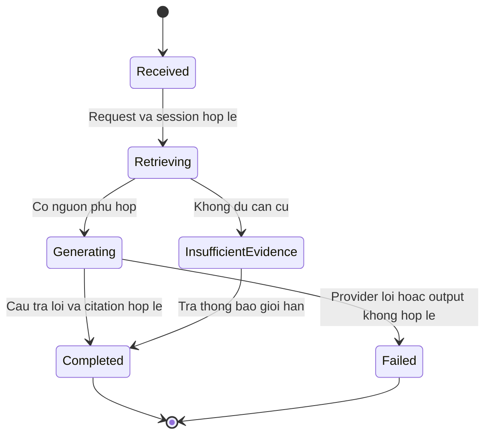

Đây là lượt xử lý, không phải status của chat_sessions. Phiên chat có IsActive theo ERD; việc đóng/mở hoặc xóa phiên còn cần API và chính sách riêng.

### 3.7. AIOCR — Kết quả quét CCCD [DỰ KIẾN]

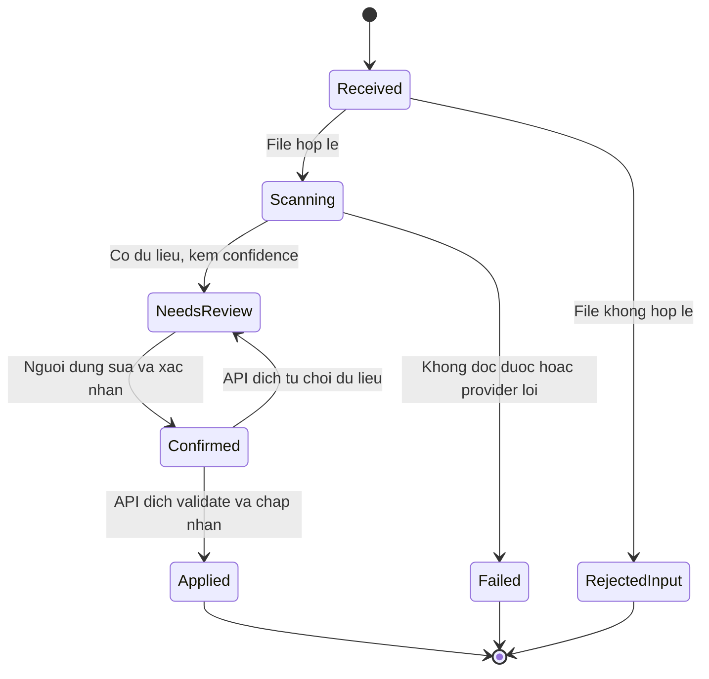

Trạng thái xác nhận mô tả quy trình, chưa được lưu trong ocr_scan_logs theo thiết kế gốc. Khi triển khai phải quyết định dữ liệu tạm nằm ở client hay backend và thời hạn xóa.

### 3.8. AnalyticsSystem — Delivery hiện tại và receipt tương lai

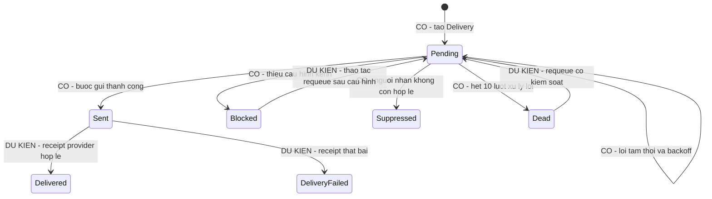

Chưa có API vận hành requeue trong code hiện tại. `Delivered`/`DeliveryFailed` là đề xuất metadata receipt, có thể lưu riêng với State vận chuyển; không giả định provider nào cũng có callback. `Notification.IsRead` độc lập với Delivery.State.

### 3.9. AnalyticsSystem — Preparation Reference [DỰ KIẾN]

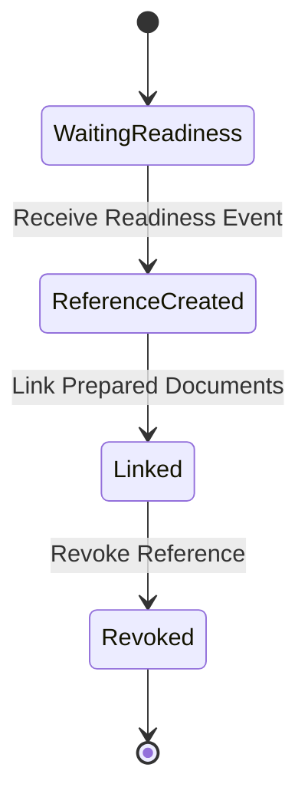

Quyền xem tham chiếu và điều kiện thu hồi cần được thiết kế khi triển khai. Feedback chỉ đánh giá trải nghiệm hỗ trợ chuẩn bị hồ sơ, không mặc nhiên chứng minh đã giải quyết thủ tục tại phường.

### 3.10. AnalyticsSystem — Backup [DỰ KIẾN]

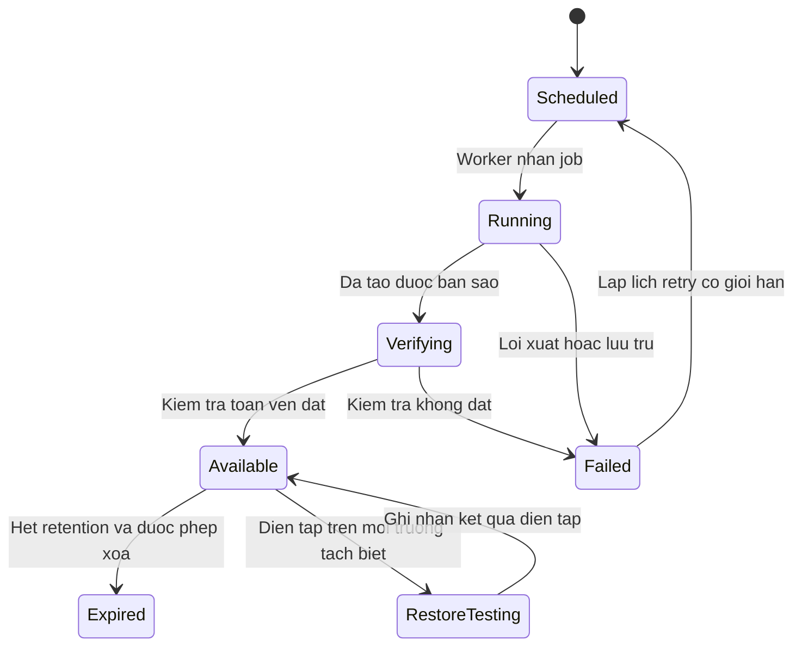

Kết quả restore cần log riêng hoặc metadata bổ sung; không dùng `Available` như bằng chứng đã phục hồi thành công. Backup/restore thật không được chạy từ yêu cầu vẽ sơ đồ này.

## 4. Structure Analysis — Cấu trúc chức năng và dữ liệu đích

### 4.1. FDD — Phân rã chức năng đủ 6 service

```mermaid
flowchart TB
    WM["WardMate Backend đích"]
    WM --> IAM["1. IAM"]
    IAM --> I1["[CÓ] Auth, refresh, profile, account, ward, RBAC"]
    IAM --> I2["[DỰ KIẾN] Audit tập trung / cache quyền phân tán"]
    WM --> PC["2. ProcedureCatalog"]
    PC --> P1["[CÓ] CRUD, categories, search, versions, checklist, PDF drafts"]
    PC --> P2["[DỰ KIẾN] Đồng bộ nguồn RAG theo phiên bản/hiệu lực"]
    WM --> WF["3. ApplicationWorkflow"]
    WF --> W1["[CÓ] Hồ sơ, checklist snapshot, review, diff, Outbox"]
    WF --> W2["[CHỜ SỬA CODE] Xác nhận giấy tờ sẵn sàng, đồng bộ tài liệu"]
    WM --> DF["4. DocumentForm"]
    DF --> D1["[CÓ] Phôi/schema, biểu mẫu, minh chứng, Blob, PDF"]
    DF --> D2["[DỰ KIẾN] PDF chuẩn bị, QR tham chiếu; không ký quyết định hành chính"]
    WM --> AI["5. AIOCR"]
    AI --> A1["[CÓ] PDF text, AI schema, warnings, retry"]
    AI --> A2["[MỘT PHẦN] OCR PDF cần cấu hình thật"]
    AI --> A3["[DỰ KIẾN] KB/chunk/vector/RAG/chat, OCR CCCD, logs"]
    WM --> NS["6. AnalyticsSystem"]
    NS --> N1["[CÓ] Notification, Inbox/Delivery, SignalR"]
    NS --> N2["[MỘT PHẦN] Email/SMS qua nhà cung cấp thật"]
    NS --> N3["[DỰ KIẾN] QR, feedback, metrics/dashboard theo phường"]
    NS --> N4["[DỰ KIẾN] Audit/settings, health history, backup/restore checks"]
```

### 4.2. DFD ngữ cảnh đích — Actor và hệ thống ngoài

```mermaid
flowchart LR
    Citizen["Công dân"] -->|"[CÓ] tài khoản, hồ sơ, giấy tờ"| WM(("WardMate"))
    WM -->|"[CÓ] thủ tục, trạng thái, PDF, thông báo"| Citizen
    Citizen -->|"[DỰ KIẾN] chat, ảnh CCCD, đánh giá"| WM
    WM -->|"[DỰ KIẾN] trả lời có nguồn, dữ liệu quét, QR"| Citizen
    Officer["Front Desk"] -->|"[CÓ] thẩm định đúng phường"| WM
    Manager["Manager"] -->|"[CÓ] quản lý cán bộ cùng phường"| WM
    WM -->|"[DỰ KIẾN] dashboard giới hạn phường"| Manager
    PM["Procedure Manager"] -->|"[CÓ] thủ tục, PDF, checklist, phôi"| WM
    Admin["IT Admin"] -->|"[CÓ] tài khoản và RBAC"| WM
    Admin -->|"[DỰ KIẾN] settings, audit, vận hành"| WM
    WM -->|"[CÓ/MỘT PHẦN] nội dung PDF theo cấu hình"| AI["Nhà cung cấp AI/OCR"]
    AI -->|"Kết quả hoặc lỗi"| WM
    WM -->|"[DỰ KIẾN] nội dung thông báo ngoài hệ thống"| Telecom["SMS/Email provider"]
    Telecom -->|"[DỰ KIẾN] kết quả/receipt theo khả năng provider"| WM
```

Blob, PostgreSQL, RabbitMQ là hạ tầng dữ liệu, không phải actor người dùng. Phần FE chỉ xuất hiện như bên gọi/nhận dữ liệu; task này không xây màn hình FE.

### 4.3. DFD mức 1 — Sáu tiến trình và sáu vùng dữ liệu

```mermaid
flowchart TB
    Client["Công dân / cán bộ qua Gateway"]
    P1(("1. IAM"))
    P2(("2. ProcedureCatalog"))
    P3(("3. ApplicationWorkflow"))
    P4(("4. DocumentForm"))
    P5(("5. AIOCR"))
    P6(("6. AnalyticsSystem"))
    D1[("D1 IAM - CÓ")]
    D2[("D2 Procedure - CÓ")]
    D3[("D3 Workflow - CÓ")]
    D4[("D4 Document - CÓ")]
    D5[("D5 AI/RAG - DỰ KIẾN")]
    D6[("D6 Notifications CÓ; Analytics/Ops DỰ KIẾN")]
    Client -->|"Auth / quản trị [CÓ]"| P1
    P1 --> D1
    Client -->|"Tra cứu / quản lý [CÓ]"| P2
    P2 --> D2
    Client -->|"Hồ sơ, góp ý và xác nhận sẵn sàng [ĐÍCH]"| P3
    P3 --> D3
    Client -->|"Biểu mẫu / file [CÓ]"| P4
    P4 --> D4
    P2 -->|"PDF extraction [CÓ]"| P5
    P5 -->|"Payload / warnings [CÓ]"| P2
    P2 -.->|"Nguồn tri thức [DỰ KIẾN]"| P5
    Client -.->|"Chat / OCR CCCD [DỰ KIẾN]"| P5
    P5 -.-> D5
    P2 -->|"Thủ tục và checklist [CÓ]"| P3
    P4 -->|"Thông tin tài liệu [CÓ]"| P3
    P3 -->|"Quyền/phạm vi và trạng thái hồ sơ [CÓ]"| P4
    P3 -->|"Workflow event [CÓ]"| P6
    P6 --> D6
    P1 -->|"Người nhận và quyền/phường [CÓ]"| P6
    P6 -.->|"QR nguồn [DỰ KIẾN]"| P4
    P4 -.->|"Kết quả PDF [DỰ KIẾN]"| P6
    Client -->|"Đọc thông báo [CÓ]"| P6
    Client -.->|"Feedback / dashboard [DỰ KIẾN]"| P6
```

Không service nào đọc database của service khác trong thiết kế này. DFD gộp đọc/ghi mỗi datastore thành một cạnh để dễ nhìn, không phải danh sách các SQL command hoặc HTTP endpoint đầy đủ.

### 4.4. Thành phần triển khai đích và các phần còn thiếu

```mermaid
flowchart LR
    Edge["[CÓ] YARP + JWT/CORS theo cấu hình"] --> Services["[CÓ] API của 6 service"]
    Services --> ExistingDb["[CÓ] 5 database nghiệp vụ hiện tại"]
    Services -.-> FutureDb["[DỰ KIẾN] AI DB + pgvector; mở rộng System DB"]
    Services --> Blob["[CÓ] Blob abstraction / Azure hoặc Azurite"]
    Services --> Bus["[CÓ] RabbitMQ: Workflow → Notifications"]
    Bus -.-> MoreEvents["[DỰ KIẾN] Catalog indexing / QR / PDF / metrics / audit events"]
    Services --> AIProvider["[CÓ/MỘT PHẦN] AI/OCR tùy cấu hình"]
    Services --> PDF["[CÓ] Gotenberg"]
    Services -.-> Cache["[DỰ KIẾN] Redis cache quyền/danh mục và invalidation"]
    Services -.-> Observability["[DỰ KIẾN/CHƯA XÁC NHẬN ĐỦ] tracing/log tập trung, dashboards vận hành"]
    Services -.-> Channels["[MỘT PHẦN] SMTP; [DỰ KIẾN] SMS adapter thật"]
    Services -.-> RealtimeScale["[DỰ KIẾN] Backplane hoặc Azure SignalR khi nhiều replica"]
    Services -.-> Backup["[DỰ KIẾN] Scheduler backup, retention, kiểm tra restore"]
```

Không coi container Redis hoặc thư viện logging có mặt là bằng chứng đã hoàn thành cache/observability end-to-end. Các integration event mới cần hợp đồng version, publisher/consumer idempotent và retry; cơ chế Outbox hiện tại không tự áp dụng cho mọi service.

## 5. Liên kết task và các quyết định chưa chốt

| Nhóm công việc trong kế hoạch | Phần sơ đồ liên quan | Tình trạng |
| --- | --- | --- |
| Kiểm tra giấy tờ, xác nhận sẵn sàng, PDF chuẩn bị | 2.3, 2.4, 2.8, 3.4, 3.9 | Phạm vi mới đã chốt; code cũ phải sửa sau khi hoàn thành sơ đồ; QR tham chiếu chưa làm |
| TASK-25: Notifications + SignalR | 2.7, 3.8 | Có code; scale nhiều replica còn thiếu |
| TASK-26: SMS/Email | 2.7, 3.8 | Adapter Email có một phần; tích hợp thật đang để sau |
| TASK-27: Event-driven notifications | 2.7, 4.3 | Workflow → Notifications có; các event tương lai khác chưa có |
| Knowledge Base/chunk/vector/Gemini RAG | 2.5, 3.5, 3.6 | Dự kiến |
| OCR CCCD | 2.6, 3.7 | Dự kiến; không nhầm với đọc text PDF |
| Metrics/dashboard/đánh giá công dân | 2.8, 3.9 | Dự kiến |
| Audit/config/health/backup | 2.9, 3.10 | Audit RBAC và health endpoint có một phần; nền tảng tập trung chưa hoàn chỉnh |
| Index tuning/tài liệu API/kiểm thử tích hợp | Xuyên suốt | Có tài liệu và checks lịch sử; chưa xác nhận toàn luồng đích/Azure |

Trước khi code các phần tương lai cần chốt: luật hủy hồ sơ; điều kiện đánh giá; phạm vi công khai/thu hồi QR; bộ giấy tờ chuẩn bị là một hay nhiều PDF; phường lịch sử của metrics; model embedding/dimension; dữ liệu OCR/chat được giữ bao lâu; provider SMS/Email; cơ chế chống race khi xác nhận sẵn sàng và cập nhật tài liệu đồng thời.

Không yêu cầu người dùng chốt ngay để hoàn thành bản vẽ này. Các điểm trên là đầu vào cho từng task triển khai, chưa phải thay đổi ràng buộc hiện hành trong [system-constraints.md](system-constraints.md).

## 6. Nguồn và lịch sử

- Source hiện trạng: các entity/EF mapping được dẫn ở [system-diagrams.md, mục 5](system-diagrams.md#5-nguồn-đối-chiếu-và-giới-hạn).
- Đối chiếu thêm: IAM `Application/Commands` và `Application/Accounts`; AIOCR `Infrastructure/Extraction/TextFirstProcedureExtractor.cs`; AnalyticsSystem `Infrastructure/NotificationDeliveryWorker.cs`, `NotificationInboxWorker.cs`, `ExternalNotificationSender.cs`.
- Phạm vi tương lai: đặc tả backend gốc 35 bảng và danh sách task chủ dự án cung cấp. Các trạng thái xử lý job, hủy, requeue, receipt, thu hồi QR là **đề xuất thiết kế**, không được gán nhãn tính năng đã hoàn tất.
- 15/10/2026: tạo 9 Activity, 10 State Machine, 4 Structure Analysis, ma trận 6 service và liên kết từ bộ sơ đồ chính. Không chỉnh sửa code, migration hoặc API.
