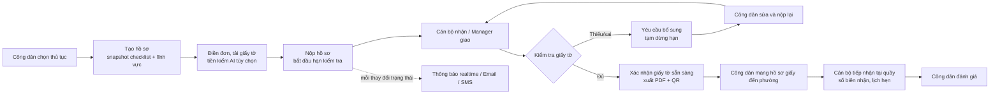
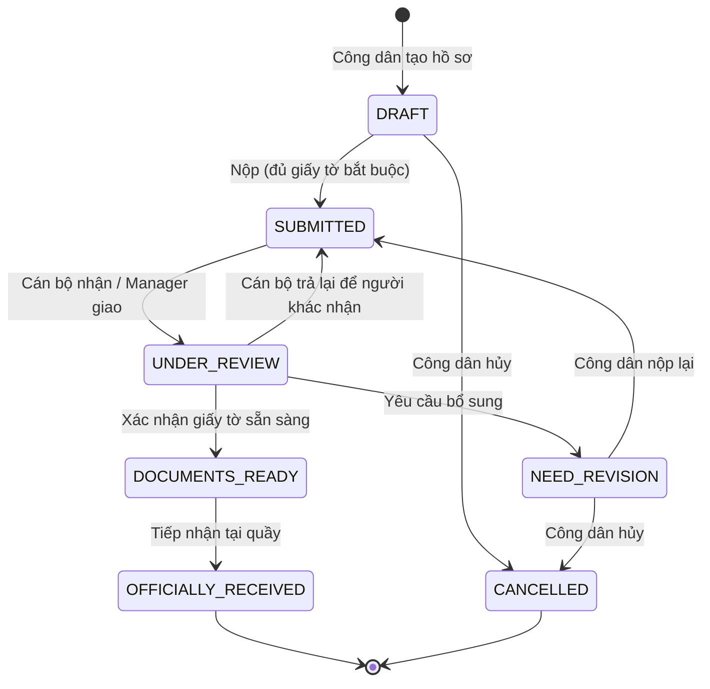

# WardMate — Các luồng chính (main flow) của hệ thống

Cập nhật 28/10/2026 (UTC+07:00). Mô tả theo source backend hiện tại (6 service + Gateway). Đây là luồng nghiệp vụ đã có trong code; trạng thái deploy/Azure và nghiệm thu giao diện không được khẳng định ở đây. Chi tiết request/response xem [api-guide.md](api-guide.md), ràng buộc xem [system-constraints.md](system-constraints.md).

**Phạm vi nghiệp vụ:** WardMate hỗ trợ công dân **chuẩn bị và kiểm tra giấy tờ** trước khi đến phường. `DOCUMENTS_READY` nghĩa là giấy tờ đã sẵn sàng; `OFFICIALLY_RECEIVED` nghĩa là phường đã tiếp nhận hồ sơ giấy tại quầy. Hệ thống **không** ra quyết định phê duyệt/từ chối thủ tục hành chính.

## Tác nhân

| Tác nhân | Vai trò trong hệ thống |
|---|---|
| Công dân (REGISTERED_CITIZEN) | Tạo, chuẩn bị, nộp, sửa và hủy hồ sơ của mình; hỏi trợ lý AI; đánh giá |
| Cán bộ một cửa (FRONT_DESK_OFFICER) | Nhận hồ sơ trong phường, kiểm tra giấy tờ, yêu cầu bổ sung, xác nhận sẵn sàng, tiếp nhận tại quầy |
| Quản lý phường (MANAGER) | Giám sát hồ sơ trong phường, giao/chuyển người phụ trách, xem thống kê; không tự kiểm tra hồ sơ |
| Quản lý thủ tục (PROCEDURE_MANAGER) | Quản lý danh mục thủ tục, checklist, biểu mẫu, Knowledge Base |
| Quản trị hệ thống (IT_ADMIN) | Tài khoản, phân quyền, quản trị thông báo lỗi, Knowledge Base, chạy lại job thống kê |

## Tổng quan luồng hồ sơ

## Vòng đời trạng thái hồ sơ

---

## MF-01. Đăng ký, đăng nhập và bảo mật tài khoản

**Tác nhân:** Công dân, mọi người dùng. **Service:** IAM.

1. Công dân đăng ký tài khoản (`POST /api/v1/auth/register`); hệ thống tạo tài khoản với vai trò REGISTERED_CITIZEN và xếp email chào mừng vào hàng đợi gửi.
2. Người dùng đăng nhập (`POST /api/v1/auth/login`) và nhận access token (JWT) cùng refresh token. Web giữ refresh token trong cookie HttpOnly; ứng dụng di động gửi `X-Client-Type: Mobile` để nhận refresh token trong JSON.
3. Khi access token hết hạn, client gọi `POST /api/v1/auth/refresh`; refresh token được xoay vòng (dùng một lần).
4. Mỗi request vào các service khác được kiểm tra lại với IAM (`/api/v1/users/access-context`): tài khoản còn hoạt động, phiên chưa bị thu hồi, vai trò và phường hiện tại.
5. Quên mật khẩu: người dùng yêu cầu OTP qua Email hoặc SMS (`/api/v1/auth/password-otp/request`), nhập OTP và mật khẩu mới (`/verify-and-change`). OTP 6 số, hiệu lực 5 phút, tối đa 5 lần nhập sai, chờ 60 giây giữa hai lần gửi.
6. Muốn nhận OTP qua SMS, người dùng phải xác minh số điện thoại trước (nhập mật khẩu hiện tại + OTP gửi tới số mới).

**Ngoại lệ:** đổi mật khẩu thu hồi toàn bộ refresh token và vô hiệu access token ở request kế tiếp; IAM không phản hồi → các service trả 503, không tự cho qua.

## MF-02. Quản lý danh mục thủ tục

**Tác nhân:** Quản lý thủ tục. **Service:** Procedure Catalog, AIOCR.

1. Quản lý thủ tục tải file PDF văn bản thủ tục (`POST /api/v1/procedure-manager/drafts`) hoặc xem thử kết quả bóc tách (`/extract-preview`).
2. AIOCR đọc lớp chữ của PDF (và AI nếu được bật) để bóc tách: tên, lĩnh vực, cơ quan, phí, thời hạn, các trường hợp, trình tự, thành phần hồ sơ, biểu mẫu, căn cứ pháp lý. Kết quả lưu thành bản nháp.
3. Quản lý thủ tục đối soát bản nháp với PDF gốc (`GET /drafts/{id}/source`), chỉnh sửa (`PUT /drafts/{id}`), chạy lại nếu lỗi (`/retry`).
4. Xuất bản (`POST /drafts/{id}/publish`): tạo thủ tục mới hoặc phiên bản mới của thủ tục; phiên bản cũ được lưu để khôi phục.
5. Quản lý checklist giấy tờ của thủ tục (bắt buộc/không, bản chính/sao, số lượng, theo trường hợp) và gắn biểu mẫu DOCX.
6. Công dân tra cứu thủ tục đang áp dụng (`GET /api/v1/procedures`, chi tiết, thủ tục nổi bật).

**Ngoại lệ:** bóc tách lỗi hoặc thiếu dữ liệu → bản nháp ghi cảnh báo, không tự xuất bản; thủ tục ngừng áp dụng thì công dân không tạo được hồ sơ mới.

## MF-03. Công dân tạo và nộp hồ sơ

**Tác nhân:** Công dân. **Service:** Application Workflow, Document Form, AIOCR.

1. Công dân chọn thủ tục và phường, tạo hồ sơ (`POST /api/v1/applications`). Hệ thống chụp lại (snapshot) checklist giấy tờ và lĩnh vực của thủ tục tại thời điểm tạo; thay đổi thủ tục về sau không ảnh hưởng hồ sơ này. Hồ sơ ở trạng thái `DRAFT`.
2. Công dân điền đơn trực tuyến hoặc tải lên đơn DOCX đã điền (`/api/v1/citizen/submissions/...`), gắn với hồ sơ và đúng mục checklist.
3. Công dân tải giấy tờ minh chứng (`POST /api/v1/applications/{id}/supporting-documents`) theo từng mục checklist; có thể xem trước PDF/ảnh.
4. (Tùy chọn) Công dân dùng trợ lý AI:
   - Đọc CCCD từ ảnh để gợi ý điền thông tin (`POST /api/v1/ai-ocr/cccd/extract`).
   - Tiền kiểm một giấy tờ đã tải lên: mờ/lóa, đúng loại theo mục checklist (`POST /api/v1/ai-ocr/documents/verify`). Kết quả chỉ là gợi ý.
5. Công dân đánh dấu hoàn tất từng mục checklist (`PATCH /applications/{id}/checklists/{checklistId}`).
6. Công dân nộp hồ sơ (`POST /api/v1/applications/{id}/submit`). Hệ thống kiểm tra phía server: đủ mục bắt buộc và giấy tờ thực sự tồn tại; cấp mã hồ sơ; lưu phiên bản nộp đầu tiên; bắt đầu tính **hạn kiểm tra giấy tờ** (45 giờ làm việc, thứ Hai–thứ Sáu 07:30–16:30). Trạng thái chuyển `SUBMITTED`.
7. Hệ thống phát sự kiện để thông báo cho công dân và các cán bộ cùng phường (MF-08).

**Ngoại lệ:** thiếu giấy tờ bắt buộc → 422 kèm danh sách mục thiếu; hồ sơ chưa có phường → không cho nộp; công dân có thể hủy hồ sơ khi còn `DRAFT` hoặc `NEED_REVISION`.

## MF-04. Phân công hồ sơ cho cán bộ

**Tác nhân:** Cán bộ một cửa, Quản lý phường. **Service:** Application Workflow, IAM.

1. Cán bộ mở hàng đợi hồ sơ của phường mình (`GET /api/v1/officer/applications/pending` hoặc danh sách tổng hợp). Hồ sơ thuộc lĩnh vực cán bộ phụ trách được xếp lên trước nhưng không ẩn lĩnh vực khác; có lọc theo lĩnh vực, người phụ trách, quá hạn.
2. Cán bộ nhận hồ sơ (`POST /officer/applications/{id}/assign`): hồ sơ chuyển `UNDER_REVIEW`, ghi người phụ trách và lịch sử phân công. Hai cán bộ nhận cùng lúc thì chỉ một người thành công.
3. Quản lý phường có thể **giao** hồ sơ chưa ai nhận, hoặc **chuyển** hồ sơ đang xử lý sang cán bộ khác (`PUT /api/v1/manager/applications/{id}/assignee`), bắt buộc ghi lý do. Cán bộ đích phải cùng phường, đang hoạt động, không phải người nộp hồ sơ.
4. Cán bộ đang phụ trách có thể **trả lại** hồ sơ `UNDER_REVIEW` (`POST /officer/applications/{id}/release`) kèm lý do; hồ sơ về `SUBMITTED` để người khác nhận.
5. Mọi lần nhận/giao/chuyển/trả đều được lưu lịch sử và thông báo cho người liên quan; hạn kiểm tra không bị đặt lại.

**Ngoại lệ:** dữ liệu phân công đã đổi trong lúc thao tác → 409, tải lại; cán bộ không phải người phụ trách → 403; lý do nội bộ không hiển thị cho công dân.

## MF-05. Kiểm tra giấy tờ, yêu cầu bổ sung và nộp lại

**Tác nhân:** Cán bộ một cửa, Công dân. **Service:** Application Workflow, Document Form.

1. Cán bộ đang phụ trách xem hồ sơ, đơn và giấy tờ minh chứng của phiên bản hiện tại.
2. Cán bộ ghi nhận xét tại từng ô dữ liệu hoặc từng mục checklist (`POST /officer/applications/{id}/comments`).
3. Nếu có thiếu sót, cán bộ yêu cầu bổ sung (`POST /officer/applications/{id}/request-revision`) kèm ghi chú. Hồ sơ chuyển `NEED_REVISION`; hạn kiểm tra **tạm dừng** trong thời gian chờ công dân.
4. Công dân xem nhận xét (`GET /api/v1/applications/{id}/comments`), sửa đơn và giấy tờ rồi nộp lại (`POST /api/v1/applications/{id}/resubmit`). Hệ thống lưu phiên bản mới, đóng các nhận xét cũ, **tiếp tục** tính hạn (cộng thêm thời gian đã tạm dừng). Hồ sơ về `SUBMITTED` và vẫn giữ cán bộ phụ trách.
5. Cán bộ so sánh hai phiên bản (`GET /applications/{id}/diff?fromVersion=&toVersion=`) để chỉ xem phần đã sửa, rồi tiếp tục kiểm tra.

**Ngoại lệ:** công dân nộp lại trên phiên bản cũ → 409; thiếu mục bắt buộc → 422.

## MF-06. Xác nhận giấy tờ sẵn sàng, xuất PDF và mã QR

**Tác nhân:** Cán bộ một cửa, Công dân. **Service:** Application Workflow, Document Form.

1. Khi giấy tờ đủ và đúng, cán bộ xác nhận (`POST /officer/applications/{id}/confirm-readiness`). Hệ thống kiểm tra: đúng người phụ trách và phường, không còn nhận xét mở, đủ checklist bắt buộc, giấy tờ tồn tại ở Document Form.
2. Hồ sơ chuyển `DOCUMENTS_READY`, ghi thời điểm sẵn sàng; hạn kiểm tra được đánh giá đúng hạn hay trễ hạn.
3. Công dân hoặc cán bộ xuất bộ hồ sơ PDF (`POST /api/v1/applications/{id}/generate-pdf`); PDF được đóng mã QR tham chiếu hồ sơ.
4. Công dân tải PDF (`GET /generated-documents/{documentId}/download`) và mang bản giấy đến phường. Quét mã QR mở bản PDF mới nhất của hồ sơ.

**Ngoại lệ:** còn nhận xét mở → 409; giấy tờ không đáp ứng → 422; sau `DOCUMENTS_READY` hồ sơ bị khóa chỉnh sửa.

## MF-07. Tiếp nhận hồ sơ giấy tại quầy

**Tác nhân:** Cán bộ một cửa, Công dân. **Service:** Application Workflow.

1. Công dân đến phường với bộ hồ sơ giấy.
2. Cán bộ đang phụ trách đối chiếu bản giấy và ghi nhận tiếp nhận (`POST /officer/applications/{id}/officially-received`), có thể kèm ghi chú và ngày hẹn.
3. Hệ thống cấp số biên nhận, ghi thời điểm tiếp nhận; hồ sơ chuyển `OFFICIALLY_RECEIVED` và công dân được thông báo.
4. Công dân gửi đánh giá mức độ hài lòng 1–5 sao (MF-10).

**Ngoại lệ:** hồ sơ chưa `DOCUMENTS_READY` hoặc đã tiếp nhận → 409; Quản lý phường không được tiếp nhận thay cán bộ.

## MF-08. Thông báo

**Tác nhân:** Hệ thống, mọi người dùng. **Service:** Application Workflow, RabbitMQ, Analytics System, IAM.

1. Mỗi thay đổi hồ sơ (nộp, nhận, bổ sung, sẵn sàng, tiếp nhận, hủy, nhận xét, phân công) được ghi vào outbox trong cùng giao dịch với thay đổi đó.
2. Worker gửi sự kiện qua RabbitMQ; Analytics nhận và lưu vào inbox (chống trùng theo mã sự kiện).
3. Hệ thống xác định người nhận theo loại sự kiện (công dân, cán bộ phụ trách, các cán bộ cùng phường), kiểm tra lại với IAM, tạo thông báo.
4. Gửi theo từng kênh: trong ứng dụng qua SignalR (realtime, đồng bộ giữa nhiều replica), Email (HTML + văn bản), SMS qua eSMS (khi được bật).
5. Người dùng xem danh sách, số chưa đọc, đánh dấu đã đọc.
6. Lần gửi lỗi được thử lại có giới hạn; IT_ADMIN xem lần gửi lỗi, đối soát SMS chưa rõ kết quả với eSMS và gửi lại có kiểm soát (`/api/v1/admin/notification-deliveries`).

**Ngoại lệ:** "đã gửi" nghĩa là nhà cung cấp đã nhận, không chứng minh người dùng đã đọc; SMS không rõ kết quả không tự gửi lại để tránh trùng tin và tốn phí.

## MF-09. Trợ lý AI và Knowledge Base

**Tác nhân:** Công dân, Quản lý thủ tục, IT_ADMIN. **Service:** AIOCR, Procedure Catalog, IAM.

1. Quản lý thủ tục/IT_ADMIN xây Knowledge Base (`/api/v1/ai/knowledge`): đồng bộ nội dung thủ tục đang áp dụng từ Catalog, nhập văn bản/FAQ, tải PDF có chữ. Hệ thống tự chia đoạn theo mục.
2. Khi bật tạo vector, worker tạo embedding cho từng đoạn; người quản lý xem trạng thái và tìm thử để kiểm tra chất lượng nguồn.
3. Công dân hỏi chatbot (`POST /api/v1/ai/chat/completions`). Khi bật chế độ RAG: hệ thống tìm các đoạn liên quan nhất; nếu có, chatbot chỉ trả lời dựa trên các đoạn đó và kèm trích dẫn [1], [2] cùng thủ tục liên quan; nếu không có nguồn phù hợp, trả lời "chưa đủ thông tin" và hướng dẫn hỏi cán bộ.
4. Lịch sử phiên chat và nguồn trích dẫn được lưu; công dân xem lại các phiên của mình.

**Ngoại lệ:** tạo vector và RAG mặc định tắt (khi tắt, chatbot trả lời như trước, không dẫn nguồn); câu trả lời AI chỉ để tham khảo, không thay quy định chính thức.

## MF-10. Thống kê và đánh giá

**Tác nhân:** Quản lý phường, Công dân, IT_ADMIN. **Service:** Analytics System, Application Workflow.

1. Job hằng ngày tổng hợp số liệu từ Workflow theo ngày, phường, thủ tục, cán bộ (số hồ sơ nhận, sẵn sàng, yêu cầu bổ sung, nộp lại, hủy, thời gian xử lý). IT_ADMIN có thể chạy lại cho một khoảng ngày.
2. Quản lý phường xem dashboard của phường mình: tổng quan, xu hướng theo ngày, theo thủ tục, theo cán bộ, tỷ lệ đúng/trễ hạn kiểm tra giấy tờ và hồ sơ đang quá hạn.
3. Công dân đánh giá hồ sơ đã `DOCUMENTS_READY` hoặc `OFFICIALLY_RECEIVED` (1–5 sao, nhận xét), mỗi hồ sơ một lần.
4. Quản lý phường xem danh sách và tổng hợp đánh giá trong phường.

**Ngoại lệ:** ngày chưa có dữ liệu tổng hợp được báo là thiếu, không hiển thị thành 0; hồ sơ cũ không có hạn rõ ràng không tính vào tỷ lệ đúng hạn.

## MF-11. Quản trị tài khoản và phân quyền

**Tác nhân:** IT_ADMIN, Quản lý phường. **Service:** IAM.

1. IT_ADMIN tạo tài khoản Quản lý phường (`POST /api/v1/accounts/manager`, bắt buộc phường) và Quản lý thủ tục (`POST /api/v1/accounts/procedure-manager`). Người có quyền quản lý tài khoản (Quản lý phường trong phạm vi phường mình, hoặc IT_ADMIN) tạo cán bộ một cửa (`POST /api/v1/accounts/front-desk`).
2. IT_ADMIN quản lý vai trò và quyền (RBAC); mọi thay đổi phân quyền được ghi nhật ký.
3. Quản lý phường xem danh sách cán bộ trong phường và gán lĩnh vực phụ trách; lĩnh vực được kiểm tra với Catalog và ghi nhật ký. Lĩnh vực chỉ dùng để ưu tiên hàng đợi, không chặn cán bộ nhận hồ sơ khác lĩnh vực.
4. Quyền mới có hiệu lực ngay ở request kế tiếp vì các service hỏi lại IAM mỗi request.

---

## Bảng đối chiếu luồng — service

| Luồng | IAM | Catalog | Workflow | DocumentForm | AIOCR | Analytics |
|---|:-:|:-:|:-:|:-:|:-:|:-:|
| MF-01 Tài khoản, bảo mật | ● | | | | | |
| MF-02 Danh mục thủ tục | ● | ● | | ● | ● | |
| MF-03 Tạo và nộp hồ sơ | ● | ● | ● | ● | ○ | ● |
| MF-04 Phân công | ● | | ● | | | ● |
| MF-05 Kiểm tra, bổ sung | ● | | ● | ● | | ● |
| MF-06 Sẵn sàng, PDF, QR | ● | | ● | ● | | ● |
| MF-07 Tiếp nhận tại quầy | ● | | ● | | | ● |
| MF-08 Thông báo | ● | | ● | | | ● |
| MF-09 Trợ lý AI, Knowledge Base | ● | ● | | ○ | ● | |
| MF-10 Thống kê, đánh giá | ● | | ● | | | ● |
| MF-11 Quản trị | ● | ● | | | | |

● tham gia chính · ○ tùy chọn/phụ.
