# WardMate — ERD tổng thể 6 service

> Cập nhật triển khai local 16/10/2026: luồng xác nhận giấy tờ đã được code bằng DOCUMENTS_READY/documentsReadyAt và submission ReadyForDownload. Các ảnh xuất ngày 15/10 là bản thiết kế tại thời điểm đó; nhãn “backend pending” trong ảnh đã được thay thế bởi cập nhật này. Chưa deploy/migrate Azure cho thay đổi mới. ERD cũ vẫn giữ để đối chiếu; migration DocumentReadiness bổ sung documents_ready_at.

> **Điều chỉnh phạm vi ngày 15/10/2026:** WardMate hỗ trợ chuẩn bị và kiểm tra giấy tờ trước khi đến phường; không phê duyệt hoặc từ chối giải quyết hồ sơ hành chính. Các sơ đồ Application/Document/QR dưới đây là thiết kế mới, **chưa triển khai vào backend**. `DOCUMENTS_READY` và `ReadyForDownload` là tên trạng thái đề xuất, chưa phải giá trị API. ERD được giữ nguyên để đối chiếu: các cột/trạng thái APPROVED, REJECTED, ApprovedAt và thiết kế approved_qrs/metrics cũ không có nghĩa còn thuộc phạm vi nghiệp vụ đích. Việc giải quyết chính thức tại phường nằm ngoài hệ thống.

Cập nhật 15/10/2026. Giữ nguyên [các ERD riêng](system-diagrams.md); sơ đồ dưới đây nối **42 bảng trong một hình**, không chỉ nối tên service.

## Cách đọc

- 28 bảng đã có trong source; 14 bảng có chữ **FUTURE** là **DỰ KIẾN**, chưa có entity/migration.
- IAM, CAT, WF, DOC, AI, SYS là tiền tố nhận diện service, không phải tên bảng thật trong PostgreSQL.
- **FK**: khóa ngoại vật lý hiện có; **FK_FUTURE**: khóa ngoại dự kiến. **REF**: tham chiếu logic không có FK; **REF_FUTURE**: tham chiếu của thiết kế tương lai.
- Trong hình tổng hợp này, nét liền dùng cho FK, nét đứt cho REF. Đây là quy ước của tài liệu; không suy ra identifying/non-identifying key từ kiểu nét.
- `||` là đúng 1; `|o` là 0 hoặc 1; `o{` là 0 đến nhiều. Cardinality của REF là kỳ vọng nghiệp vụ, không được database bảo đảm.
- Vẫn database-per-service; hình hợp nhất không có nghĩa gộp database hoặc tạo FK xuyên service.
- Mỗi bảng chỉ xuất hiện một lần. Các cột là phần chính lấy từ ERD riêng; xem source/migration khi cần đầy đủ.

## ERD hợp nhất

Sơ đồ lớn; mở Markdown Preview hỗ trợ Mermaid và phóng to để xem từng cụm.

```mermaid
erDiagram
    IAM_wards |o--o{ IAM_users : "FK WardId nullable"
    IAM_users ||--o| IAM_user_profiles : "FK UserId"
    IAM_users ||--o{ IAM_refresh_tokens : "FK UserId"
    IAM_users ||--o{ IAM_user_roles : "FK UserId"
    IAM_roles ||--o{ IAM_user_roles : "FK RoleId"
    IAM_roles ||--o{ IAM_role_permissions : "FK RoleId"
    IAM_permissions ||--o{ IAM_role_permissions : "FK PermissionId"
    IAM_users ||..o{ IAM_rbac_audit_logs : "REF ActorUserId"
    IAM_users |o..o{ IAM_rbac_audit_logs : "REF TargetUserId nullable"
    IAM_roles |o..o{ IAM_rbac_audit_logs : "REF RoleId nullable"
    IAM_permissions |o..o{ IAM_rbac_audit_logs : "REF PermissionId nullable"

    CAT_procedure_categories ||--o{ CAT_procedures : "FK CategoryId"
    CAT_procedures ||--o{ CAT_procedure_versions : "FK ProcedureId"
    CAT_procedures |o..o{ CAT_procedure_drafts : "REF PublishedProcedureId nullable"
    IAM_users ||..o{ CAT_procedure_drafts : "REF CreatedBy string"
    IAM_users |o..o{ CAT_procedure_drafts : "REF ReviewedBy string nullable"
    IAM_users }o..o{ CAT_procedure_categories : "REF AssignedCategories array"

    IAM_users ||..o{ WF_applications : "REF UserId - chu ho so"
    IAM_users |o..o{ WF_applications : "REF AssignedOfficerId nullable"
    IAM_wards |o..o{ WF_applications : "REF WardCode - theo Code"
    CAT_procedures ||..o{ WF_applications : "REF ProcedureId"
    WF_applications ||--o{ WF_application_checklists : "FK ApplicationId"
    WF_applications ||--o{ WF_application_versions : "FK ApplicationId"
    WF_applications ||--o{ WF_application_comments : "FK ApplicationId"
    WF_application_versions ||--o{ WF_application_comments : "FK ghep ApplicationId va ApplicationVersionId"
    WF_applications ||--o{ WF_application_status_history : "FK ApplicationId"
    IAM_users ||..o{ WF_application_comments : "REF OfficerId"
    IAM_users ||..o{ WF_application_versions : "REF SubmittedBy"
    IAM_users ||..o{ WF_application_status_history : "REF ChangedBy"
    WF_applications ||..o{ WF_workflow_outbox : "REF Payload.ApplicationId"

    DOC_form_templates ||--o{ DOC_form_template_versions : "FK TemplateId"
    DOC_form_template_versions |o--o{ DOC_user_submissions : "FK TemplateVersionId nullable"
    DOC_form_templates ||..o{ DOC_user_submissions : "REF TemplateId - khong FK truc tiep"
    CAT_procedures }o..o{ DOC_form_templates : "REF FormDefinitions JSONB - FormTemplateId"
    DOC_form_templates |o..o{ WF_application_checklists : "REF FormTemplateId nullable"
    IAM_users ||..o{ DOC_user_submissions : "REF ApplicantId"
    WF_applications |o..o{ DOC_user_submissions : "REF ApplicationId nullable"
    WF_application_checklists |o..o{ DOC_user_submissions : "REF ChecklistId nullable"
    WF_applications ||..o{ DOC_application_forms : "REF ApplicationId"
    WF_applications ||..o{ DOC_supporting_documents : "REF ApplicationId"
    WF_application_checklists |o..o{ DOC_supporting_documents : "REF ChecklistId nullable"
    WF_applications ||..o{ DOC_generated_documents : "REF ApplicationId"

    AI_FUTURE_knowledge_documents ||--o{ AI_FUTURE_knowledge_chunks : "FK_FUTURE DocumentId"
    AI_FUTURE_chat_sessions ||--o{ AI_FUTURE_chat_messages : "FK_FUTURE SessionId"
    AI_FUTURE_chat_sessions ||--o{ AI_FUTURE_ai_request_logs : "FK_FUTURE SessionId"
    CAT_procedures |o..o{ AI_FUTURE_knowledge_documents : "REF_FUTURE ProcedureId nullable"
    IAM_users ||..o{ AI_FUTURE_knowledge_documents : "REF_FUTURE UploadedBy"
    IAM_users |o..o{ AI_FUTURE_chat_sessions : "REF_FUTURE UserId nullable"
    IAM_users |o..o{ AI_FUTURE_ocr_scan_logs : "REF_FUTURE UserId nullable"
    AI_FUTURE_chat_messages }o..o{ AI_FUTURE_knowledge_chunks : "REF_FUTURE ReferencedChunkIds array"

    SYS_notifications ||--o{ SYS_notification_deliveries : "FK NotificationId"
    IAM_users ||..o{ SYS_notifications : "REF RecipientUserId"
    IAM_wards |o..o{ SYS_notifications : "REF RecipientWardCode nullable"
    WF_applications |o..o{ SYS_notifications : "REF ApplicationId nullable"
    WF_workflow_outbox ||..o| SYS_notification_inbox : "REF EventId - qua RabbitMQ"
    SYS_notification_inbox |o..o{ SYS_notifications : "REF SourceEventId nullable"
    WF_applications ||..o| SYS_FUTURE_approved_qrs : "REF_FUTURE ApplicationId unique"
    WF_applications ||..o| SYS_FUTURE_citizen_feedback : "REF_FUTURE ApplicationId unique"
    IAM_users ||..o{ SYS_FUTURE_citizen_feedback : "REF_FUTURE CitizenId"
    IAM_users ||..o{ SYS_FUTURE_daily_performance_metrics : "REF_FUTURE OfficerId"
    CAT_procedures ||..o{ SYS_FUTURE_application_procedure_metrics : "REF_FUTURE ProcedureId"
    IAM_users |o..o{ SYS_FUTURE_audit_logs : "REF_FUTURE UserId nullable"
    IAM_users ||..o{ SYS_FUTURE_system_settings : "REF_FUTURE UpdatedBy"

    IAM_wards {
        uuid Id PK
        string Code UK
        string Name
    }
    IAM_users {
        uuid Id PK
        string Username UK
        string Email UK
        string PasswordHash
        boolean IsActive
        uuid WardId FK "nullable"
        int_array AssignedCategories "IDs logic cua ProcedureCatalog"
    }
    IAM_user_profiles {
        uuid UserId PK,FK
        string FullName
        string IdentityNumber UK "nullable"
        string PhoneNumber
        date DateOfBirth
        string PermanentAddress
    }
    IAM_roles {
        int Id PK
        string RoleName UK
    }
    IAM_permissions {
        int Id PK
        string PermissionCode UK
        string Module
    }
    IAM_user_roles {
        uuid UserId PK,FK
        int RoleId PK,FK
    }
    IAM_role_permissions {
        int RoleId PK,FK
        int PermissionId PK,FK
    }
    IAM_refresh_tokens {
        uuid Id PK
        uuid UserId FK
        string Token UK "digest token"
        datetime ExpiresAt
        boolean IsRevoked
    }
    IAM_rbac_audit_logs {
        uuid Id PK
        uuid ActorUserId "khong khai bao FK"
        uuid TargetUserId "nullable"
        int RoleId "nullable"
        int PermissionId "nullable"
        string Action
        jsonb Details
        datetime CreatedAt
    }
    CAT_procedure_categories {
        int Id PK
        string CategoryName
        string Description
    }
    CAT_procedures {
        uuid Id PK
        int CategoryId FK
        string ProcedureCode UK
        string Title
        boolean IsActive
        string OriginalPdfUrl
        string PdfFileName
        jsonb ContentPayload
        jsonb ChecklistSchema
        jsonb FormDefinitions
        datetime UpdatedAt
    }
    CAT_procedure_versions {
        uuid Id PK
        uuid ProcedureId FK
        int VersionNumber "unique cung ProcedureId"
        date EffectiveDate
        string DecisionNumber
        jsonb SnapshotData
        string OriginalPdfUrl
        string PdfFileName
    }
    CAT_procedure_drafts {
        uuid Id PK
        string Status
        string BlobName
        string OriginalPdfUrl
        jsonb PayloadJson
        jsonb WarningsJson
        string ExtractedText
        uuid PublishedProcedureId "nullable - lien ket logic"
        uuid Revision "optimistic concurrency"
        uuid LeaseId "nullable"
        datetime LeaseUntil "nullable"
        int Attempts
    }
    WF_applications {
        uuid Id PK
        string ApplicationCode UK
        uuid UserId "IAM logical ID"
        uuid ProcedureId "ProcedureCatalog logical ID"
        string WardCode
        string CaseCode
        string Status
        jsonb FormData
        uuid AssignedOfficerId "nullable - IAM logical ID"
        int ResubmitCount
        datetime ApprovedAt "nullable"
    }
    WF_application_checklists {
        uuid Id PK
        uuid ApplicationId FK
        string Code "unique cung ApplicationId"
        string Title
        boolean IsRequired
        string Status
        int SortOrder
        string CaseCode
        string SubmissionType
        string DocumentCopyType
        int Quantity
        uuid FormTemplateId "nullable - logical ID"
    }
    WF_application_status_history {
        uuid Id PK
        uuid ApplicationId FK
        string FromStatus
        string ToStatus
        uuid ChangedBy "IAM logical ID"
        string Reason
        datetime CreatedAt
    }
    WF_application_versions {
        uuid Id PK
        uuid ApplicationId FK
        int VersionNumber "unique cung ApplicationId"
        jsonb SnapshotData
        uuid SubmittedBy
        datetime SubmittedAt
    }
    WF_application_comments {
        uuid Id PK
        uuid ApplicationId FK
        uuid ApplicationVersionId FK
        uuid OfficerId
        string TargetType
        string TargetId
        string CommentText
        string Status
    }
    WF_workflow_outbox {
        uuid Id PK "event ID"
        jsonb Payload
        int Attempts
        datetime NextAttemptAt
        datetime PublishedAt "nullable"
        string LastError
    }
    DOC_form_templates {
        uuid Id PK
        string Code UK
        string Title
        string FileDocxUrl
        boolean IsActive
    }
    DOC_form_template_versions {
        uuid Id PK
        uuid TemplateId FK
        int VersionNumber "unique cung TemplateId"
        string SchemaDefinition
        string MappingDefinition
        string OriginalBlobUrl
        string OriginalSha256
    }
    DOC_user_submissions {
        uuid Id PK
        uuid TemplateId "ID khong khai bao FK truc tiep"
        uuid TemplateVersionId FK "nullable"
        uuid ApplicantId "IAM logical ID"
        uuid ApplicationId "nullable - Workflow logical ID"
        uuid ChecklistId "nullable - Workflow logical ID"
        string FormData
        string BlobUrl
        string Status
    }
    DOC_application_forms {
        uuid Id PK
        uuid ApplicationId "Workflow logical ID"
        string FormData
    }
    DOC_supporting_documents {
        uuid Id PK
        uuid ApplicationId "Workflow logical ID"
        uuid ChecklistId "nullable - Workflow logical ID"
        string FileName
        string BlobUrl
        string SubmissionType
        string DocumentCopyType
        int Quantity
    }
    DOC_generated_documents {
        uuid Id PK
        uuid ApplicationId "Workflow logical ID"
        string DocumentType
        string PdfBlobUrl
    }
    AI_FUTURE_knowledge_documents {
        uuid Id PK
        uuid ProcedureId "nullable - logical ID Catalog"
        string Title
        string SourceType "MANUAL_TEXT, PDF_FILE, FAQ"
        text RawContent
        string FileUrl
        boolean IsActive
        uuid UploadedBy "logical ID IAM"
        datetime CreatedAt
        datetime UpdatedAt
    }
    AI_FUTURE_knowledge_chunks {
        uuid Id PK
        uuid DocumentId FK
        int ChunkIndex
        text ChunkContent
        vector Embedding "768 chieu theo dac ta goc"
        jsonb Metadata
        datetime CreatedAt
    }
    AI_FUTURE_chat_sessions {
        uuid Id PK
        uuid UserId "nullable - logical ID IAM"
        string Title
        boolean IsActive
        datetime CreatedAt
        datetime UpdatedAt
    }
    AI_FUTURE_chat_messages {
        uuid Id PK
        uuid SessionId FK
        string SenderRole "user, assistant, system"
        text MessageText
        uuid_array ReferencedChunkIds "mang ID logic, khong phai FK"
        datetime CreatedAt
    }
    AI_FUTURE_ai_request_logs {
        uuid Id PK
        uuid SessionId FK
        string ModelName
        int PromptTokens
        int ResponseTokens
        int LatencyMs
        int StatusCode
        text ErrorMessage
        datetime CreatedAt
    }
    AI_FUTURE_ocr_scan_logs {
        uuid Id PK
        uuid UserId "nullable - logical ID IAM"
        string DocumentType
        float ConfidenceScore
        boolean IsSuccess
        string ErrorCode
        datetime CreatedAt
    }
    SYS_notifications {
        uuid Id PK
        uuid SourceEventId "nullable - logical event ID"
        uuid RecipientUserId "IAM logical ID"
        uuid ApplicationId "nullable - Workflow logical ID"
        string RecipientWardCode
        string Title
        string Content
        string Type
        string Channel
        boolean IsRead
        datetime ReadAt
        string ActionUrl
    }
    SYS_notification_inbox {
        uuid Id PK "event ID - deduplication"
        jsonb Payload
        string State
        int Attempts
        datetime NextAttemptAt
        string ErrorCode
    }
    SYS_notification_deliveries {
        uuid Id PK
        uuid NotificationId FK
        string Channel "unique cung NotificationId"
        string State
        int Attempts
        datetime NextAttemptAt
        string ErrorCode
    }
    SYS_FUTURE_approved_qrs {
        uuid Id PK "DU KIEN"
        uuid ApplicationId UK "Workflow logical ID"
        string QrCodeUrl
        string GeneratedPdfUrl
        datetime CreatedAt
    }
    SYS_FUTURE_citizen_feedback {
        uuid Id PK "DU KIEN"
        uuid ApplicationId UK "Workflow logical ID"
        uuid CitizenId "IAM logical ID"
        int Rating "du kien 1 den 5"
        text Comment
        datetime CreatedAt
    }
    SYS_FUTURE_daily_performance_metrics {
        uuid Id PK "DU KIEN"
        uuid OfficerId "IAM logical ID"
        date MetricDate "unique cung OfficerId"
        int TotalProcessed
        int ApprovedCount
        int RevisionRequestedCount
        float AverageProcessingTimeMinutes
        datetime UpdatedAt
    }
    SYS_FUTURE_application_procedure_metrics {
        uuid Id PK "DU KIEN"
        uuid ProcedureId "Catalog logical ID"
        date MetricDate "unique cung ProcedureId"
        int TotalApplications
        int ApprovedCount
        int RejectedOrCancelledCount
        int ResubmittedCount
        datetime UpdatedAt
    }
    SYS_FUTURE_audit_logs {
        uuid Id PK "DU KIEN"
        uuid UserId "nullable - IAM logical ID"
        string Action
        string EntityName
        string EntityId
        jsonb Details
        string IpAddress
        datetime CreatedAt
    }
    SYS_FUTURE_system_settings {
        int Id PK "DU KIEN"
        string SettingKey UK
        text SettingValue
        text Description
        uuid UpdatedBy "IAM logical ID"
        datetime UpdatedAt
    }
    SYS_FUTURE_service_health_logs {
        uuid Id PK "DU KIEN"
        string ServiceName
        string Status
        int LatencyMs
        text Message
        datetime CheckedAt
    }
    SYS_FUTURE_system_backup_logs {
        uuid Id PK "DU KIEN"
        string BackupType
        string FileName
        bigint FileSizeBytes
        string StorageLocation
        string Status
        text ErrorMessage
        datetime CreatedAt
    }
```

## Những đường không được nối thành FK giả

1. `service_health_logs` và `system_backup_logs` vẫn có trong hình nhưng không có cạnh nối bảng: đặc tả chỉ có tên service/metadata backup, không có ID tham chiếu bảng khác. Chúng thuộc AnalyticsSystem và vận hành toàn hệ thống. Nối vào users/applications sẽ bịa quan hệ dữ liệu.
2. `approved_qrs.GeneratedPdfUrl` là URL, không có GeneratedDocumentId. Có liên hệ nghiệp vụ với DocumentForm nhưng chưa đủ để gán quan hệ bản ghi một-một hay một-nhiều; cần chốt trong task QR/PDF.
3. Checklist của Procedure là JSONB; checklist Application là snapshot riêng. Không có FK từ application_checklists.Code tới một bảng checklist mẫu tưởng tượng.
4. Outbox → Inbox → Notifications tương quan bằng event ID. Retention có thể khác nhau; không có FK hay transaction xuyên service giữ các bản ghi tồn tại cùng lúc.
5. Audit giữ lịch sử kể cả khi đối tượng đích bị xóa. Các đường REF ở audit không bảo đảm user/role/permission được nhắc đến còn tồn tại.
6. Không vẽ mọi CreatedBy/UpdatedBy dạng chuỗi của DocumentForm hoặc mọi ID trong snapshot để giảm giao cắt. Vẫn có đủ 42 bảng, mỗi bảng một lần.

## Nguồn và phạm vi

- FK hiện tại: entity và Fluent API dẫn tại [nguồn đối chiếu](system-diagrams.md#5-nguồn-đối-chiếu-và-giới-hạn).
- Bảng và liên kết tương lai: [ERD đích theo đặc tả](system-diagrams.md#6-erd-tương-lai--đủ-6-microservices).
- Luồng liên service: [Activity, State Machine và Structure Analysis](system-future-flows.md).
- Chỉ cập nhật tài liệu; không tạo bảng, migration, API hoặc FK xuyên database. FUTURE không phải chức năng đã triển khai.
